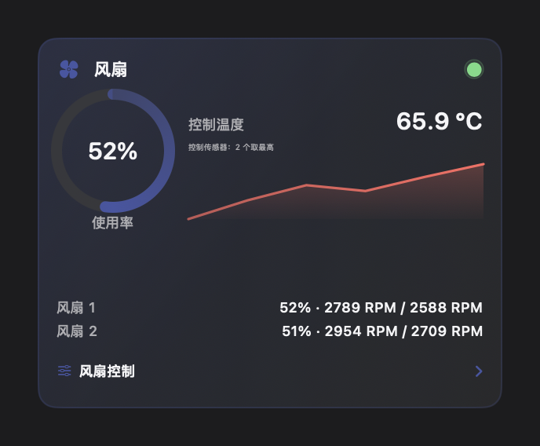
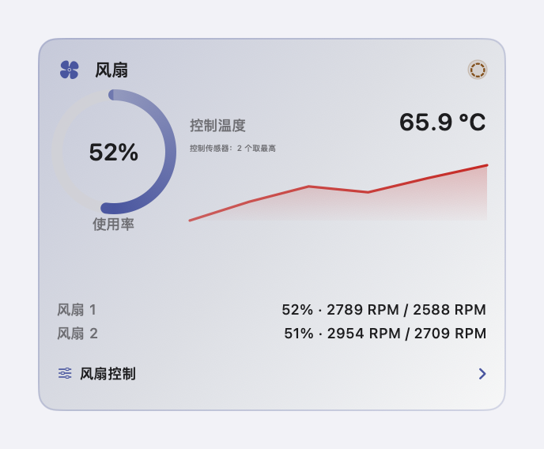

# Monitor 风扇卡片

本文定义 Monitor 页风扇卡片的结构、控制行为和故障边界。
多点曲线参考 [MacFanControl](https://github.com/skydeadpeng/MacFanControl)。
自动、手动和同步控制参考 [Stats](https://github.com/exelban/stats)。

## 1. 目标

风扇卡片有四个目标。

1. 用户不用打开其他应用就能看到风扇使用率、控制温度和风扇转速。
2. 用户能使用系统策略或四档共享风扇曲线策略。
3. 用户能选择参与控制温度的 SMC 传感器。
4. Covio 退出、崩溃或丢失 helper 租约后，系统风扇控制自动恢复。

## 2. 预览

| 亮色 | 深色 |
| --- | --- |
|  |  |
|  |  |
|  |  |
|  |  |
|  |  |
|  |  |
|  |  |
|  |  |
|  |  |
|  |  |
|  |  |
|  |  |
|  |  |

状态灯有三种视觉状态。三种状态不使用可见文字。

| Covio 已接管 | 正在接管 | 系统控制 |
| --- | --- | --- |
|  |  |  |

## 3. 三段式结构

| 段 | 折叠态 | 展开态 |
| --- | --- | --- |
| 主数值 | 风扇使用率环和控制状态灯 | 保留 |
| 趋势 | 控制目标温度的历史线 | 保留 |
| 详情 | 每台风扇的使用率、当前 RPM 和目标 RPM | 保留 |
| 详情入口 | 显示「风扇控制」和 chevron | 打开固定尺寸 popover |

风扇使用率取每台风扇 `当前 RPM ÷ 最高 RPM` 的最大值。
计算结果限制在 `0%` 到 `100%`。
标题区状态灯不显示可见文字。
绿色实心点表示 Covio 已接管。
琥珀色虚线环表示正在接管。
中性色空心圆表示系统控制。
状态灯保留 VoiceOver 标签和值。

popover 不改变卡片高度，也不移动网格。
popover 打开期间，工作台保持展开。最后一个 popover 关闭后，工作台恢复普通的指针移出收起规则。
风扇数量为 0 时，页面不显示风扇卡片。

## 4. 数据

| 数据 | 来源 | 刷新 |
| --- | --- | --- |
| 温度传感器 | AppleSMC 的 `T` 键 | 最多每 2 秒 |
| 风扇当前转速 | `F%dAc` | 最多每 2 秒 |
| 风扇目标转速 | `F%dTg` | 最多每 2 秒 |
| 风扇最小和最大转速 | `F%dMn`、`F%dMx` | 最多每 2 秒 |
| 控制温度 | 已启用温度来源的最热读数；没有来源时使用已选传感器最大值 | 跟随采样 |
| 风扇使用率 | 每台风扇当前转速除以最高转速，取最大值 | 跟随采样 |

SMC 键只在读取器初始化时枚举一次。
后续采样使用缓存键表，不反复扫描全部 SMC 键。

## 5. popover

popover 固定宽度 `420` 点。
系统控制状态高度为 `300` 点。
曲线状态高度为 `600` 点。
高级区展开后，内容可滚动。
popover 外壳使用系统原生 regular Liquid Glass。
控制区使用标准 thin material。

头部逐台风扇显示名称、当前使用率、当前 RPM 和横向进度条。
两台风扇使用「左风扇」和「右风扇」。
其他数量使用「风扇 N」。

控制区使用五档策略选择器。

| 策略 | 行为 |
| --- | --- |
| 系统 | 交还 macOS 控制 |
| 安静 | 使用低风量内置曲线 |
| 编译 | 使用较早提速的内置曲线 |
| 持续 | 使用较高风量的内置曲线 |
| 自定义 | 使用用户曲线 |

策略行右侧显示「交回 macOS」。
点击后停止曲线控制。
系统策略不持有风扇，也不写入目标转速。

非系统策略共用一条温度到风量百分比的曲线。
曲线的横轴是温度。
纵轴是风扇最高转速的百分比。
两台风扇使用同一条百分比曲线。
每台风扇写入前，百分比按自身 `Mn` 和 `Mx` 换算为 RPM。

曲线使用 SwiftUI 和 Apple Swift Charts。

| 项目 | 规范 |
| --- | --- |
| 图表组件 | `Chart`、`AreaMark`、`LineMark`、`PointMark`、`RuleMark` |
| 拖动 | `chartOverlay` + `ChartProxy` |
| 控制点数量 | 2 到 8 |
| 温度范围 | 40 °C 到 100 °C，步长 1 °C |
| 风量范围 | 0% 到 100%，步长 1% |
| 当前风量 | 所有可用风扇使用率的最高值 |
| 精确编辑 | 原生 Slider |

拖动节点时只更新本地草稿。
松手时一次提交并持久化。
节点不能越过相邻节点。

图表同时显示以下信息。

- 实线表示当前预设曲线。
- 空心节点表示可编辑控制点。
- 虚线表示当前控制温度。
- 小圆点表示当前温度下的预设目标风量。
- 双层圆点表示当前实际风量。
- 填充区域表示预设风量范围。

图例显示「实线：预设风量」和当前实际百分比。
用户可以从图判断预设请求和实际风量是否一致。

内置预设使用以下默认控制点。
用户拖动节点后，Covio 保存同名覆盖曲线。
「恢复预设」删除覆盖并恢复默认点。

| 策略 | 默认控制点 |
| --- | --- |
| 安静 | `40°C → 12%`、`55°C → 20%`、`70°C → 35%`、`85°C → 55%`、`95°C → 75%` |
| 编译 | `40°C → 20%`、`55°C → 35%`、`70°C → 55%`、`85°C → 78%`、`95°C → 95%` |
| 持续 | `40°C → 28%`、`55°C → 42%`、`70°C → 58%`、`85°C → 75%`、`95°C → 90%` |
| 自定义 | `40°C → 15%`、`55°C → 30%`、`70°C → 50%`、`90°C → 68%` |

自定义曲线默认保存 4 个节点。
用户可以增加或删除节点。
每个策略至少保留 2 个节点。

旧版按风扇保存 RPM 曲线。
旧配置打开 popover 后，Covio 把第一台风扇的 RPM 曲线换算为共享百分比曲线。
换算结果保存到「自定义」策略。
旧版手动模式保留兼容读取。
旧版手动模式不再出现在正常策略选择流程中。

高级区默认折叠。
高级区提供控制传感器列表。
传感器列表支持按名称或键名筛选。
控制温度取已选传感器中的最高值。

控制温度下降不超过 1.5 °C 时保留前一控制温度。
温度上升立即生效。
此规则减少阈值附近的转速抖动。

接管状态下，Covio 显示「交回 macOS」。
Covio 退出、崩溃或 helper 租约过期后，系统自动恢复风扇控制。
连续 3 次写入失败后，helper 恢复系统控制。

## 6. Helper 与安全

风扇写入走 Covio 唯一的全局 root helper。
Covio 不安装 MacFanControl 的第二个守护进程。
UI 不提供 helper 的独立安装、版本或修复入口。

```text
Covio UI
  -> helper socket
  -> FanControlRuntime
  -> AppleSMC
  -> fan hardware

Covio UI --每 5 秒续租--> FanControlRuntime
FanControlRuntime --20 秒无续租--> 恢复系统控制
```

曲线和手动模式每秒执行一次控制循环。
系统自动模式不启动控制循环。
连续 3 次写入失败时，helper 停止控制并恢复系统风扇模式。

以下操作会恢复系统控制。

- 用户点击「恢复系统控制」。
- 用户关闭风扇控制。
- Covio 正常退出。
- Covio 崩溃或 helper 租约过期。
- helper 收到终止信号。
- 用户卸载 helper。

Apple Silicon 使用 `F%dMd` 和 `F%dTg`。
Intel 使用 `F%dTg`，并用 `FS! ` 位掩码切换模式。
写入前记录原模式或原最小转速，恢复时写回。

## 7. 故障状态

| 状态 | 卡片表现 | 可用动作 |
| --- | --- | --- |
| 没有风扇 | 不显示卡片 | 无 |
| SMC 读取失败 | 不显示卡片 | 无 |
| Covio 系统支持不可用 | 显示读数；详情区显示能力级提示 | 重新安装 Covio |
| 系统支持版本不匹配 | 显示读数；详情区显示能力级提示 | 升级 Covio |
| 系统支持未运行 | 显示读数；详情区显示能力级提示 | 重新打开 Covio |
| 写入失败 | 恢复系统控制并显示错误 | 重试 |

读数失败不得显示 0。
未知值显示 `—`。

## 8. 无障碍

- 卡片详情入口使用按钮语义。
- 卡片状态灯同时使用颜色和不同圆点形态。
- 读屏为状态灯提供状态文字。
- 所有开关有可见标签和读屏标签。
- 可点击控件命中区不小于 24 点。
- popover 的焦点顺序与视觉顺序一致。
- 曲线图表提供可读的完整控制点摘要。
- 控制点用输入框编辑温度，用滑杆编辑风扇百分比。
- 趋势线不承载唯一信息；数值在折叠态和详情区同时可读。

## 9. 范围外

- 不实现高温通知。
- 不接管 MacFanControl 的开机自启和诊断包。
- 不引入 MacFanControl 的应用图标或文案品牌。

## 10. 依据

- 需求来源：[#313](https://github.com/wyz541/kmp-Covio/issues/313)
- 卡片对齐与状态灯：[#528](https://github.com/wyz541/kmp-Covio/issues/528)
- SMC 设备的底层读写：MacFanControl `d26184f`，MIT 许可
- 风扇模式、目标转速、恢复和睡眠逻辑：Stats `7d3f70d`，MIT 许可
- 自动模式与同步控制：Stats `7d3f70d`，MIT 许可
- 现有监控页：`macosApp/src/Hub/Monitor/MonitorTabView.swift`
- 现有快照：`macosApp/src/Hub/Monitor/MonitorSnapshot.swift`
- 功耗卡片三段式规范：[monitor-power-card.md](monitor-power-card.md)
