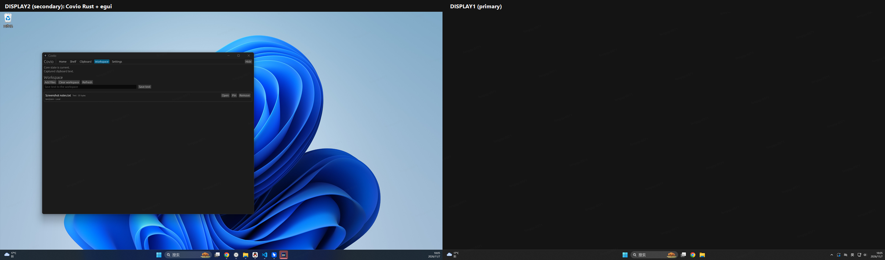
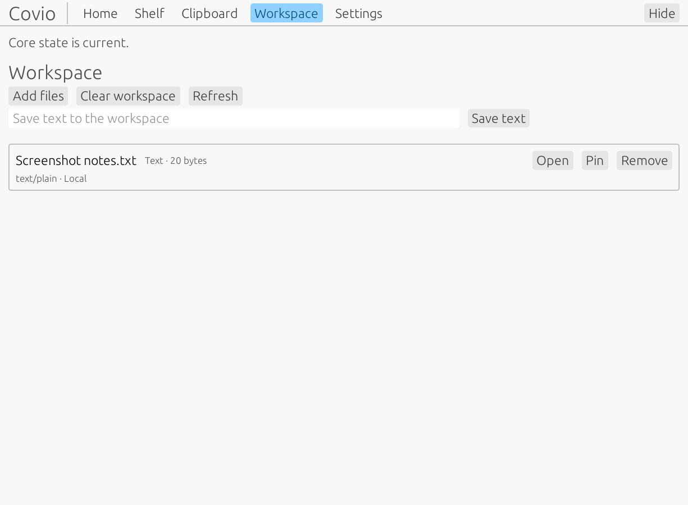
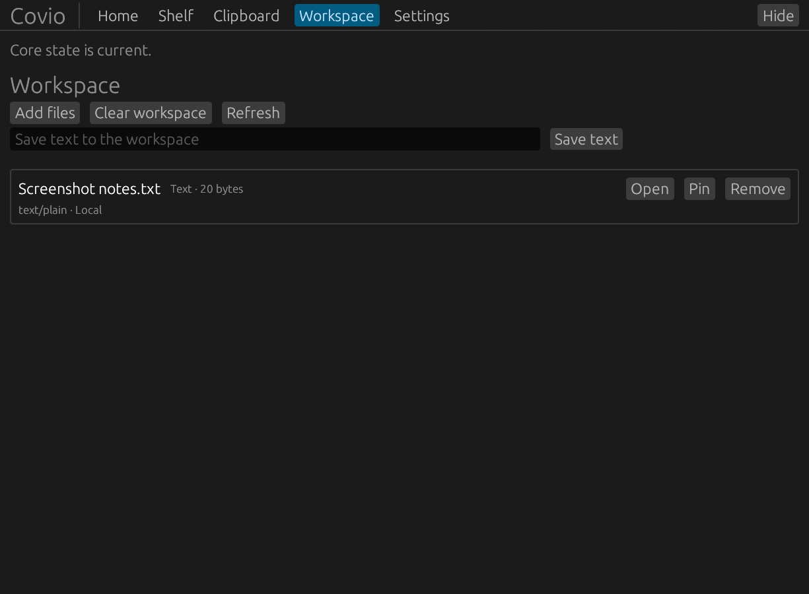
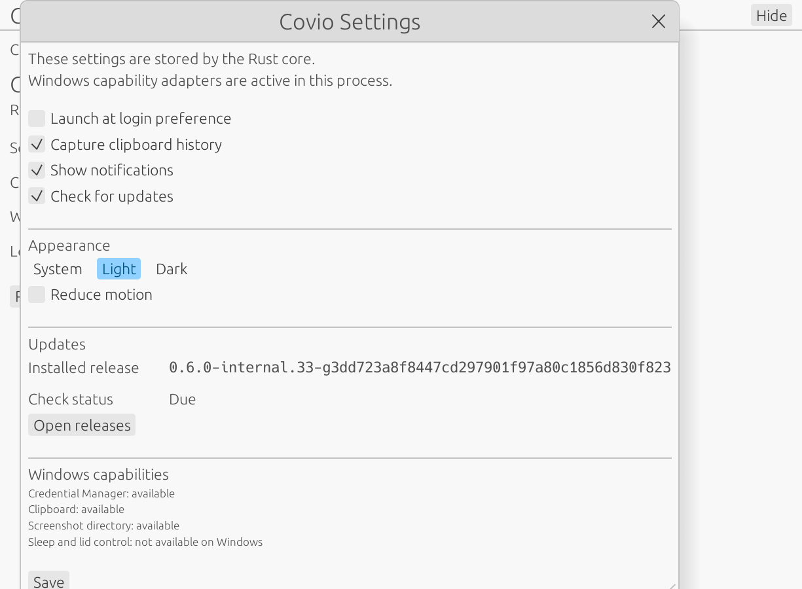
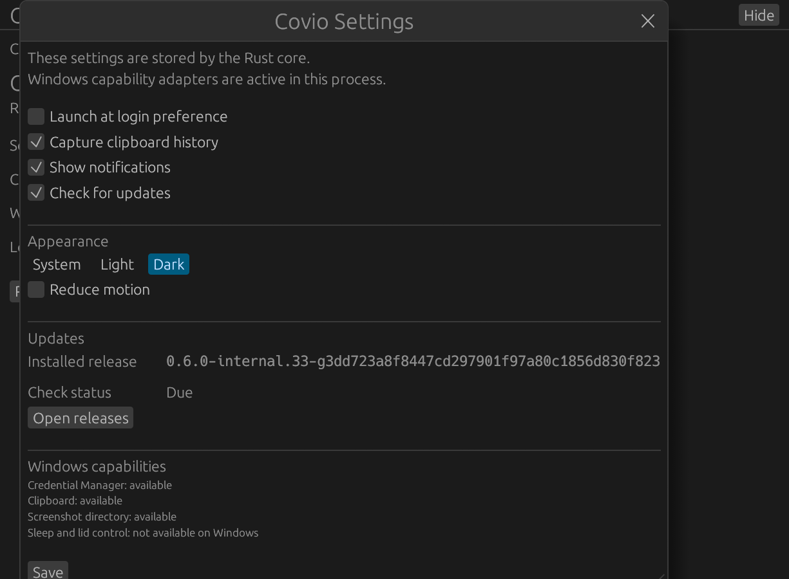
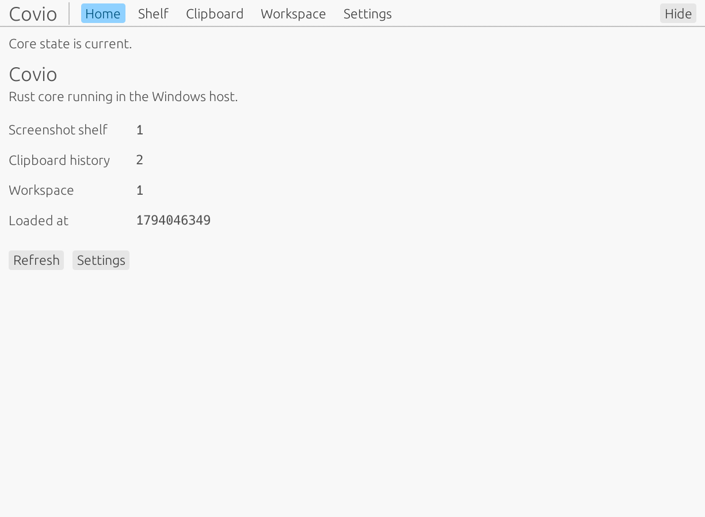
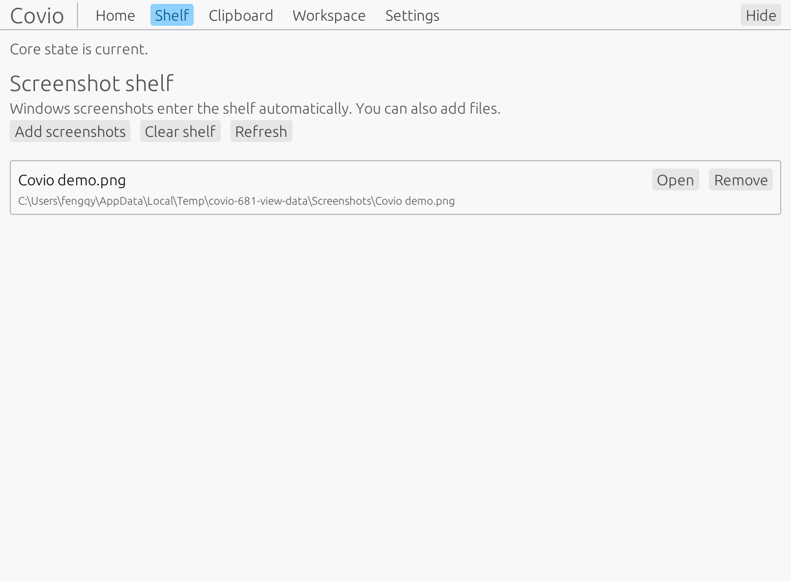
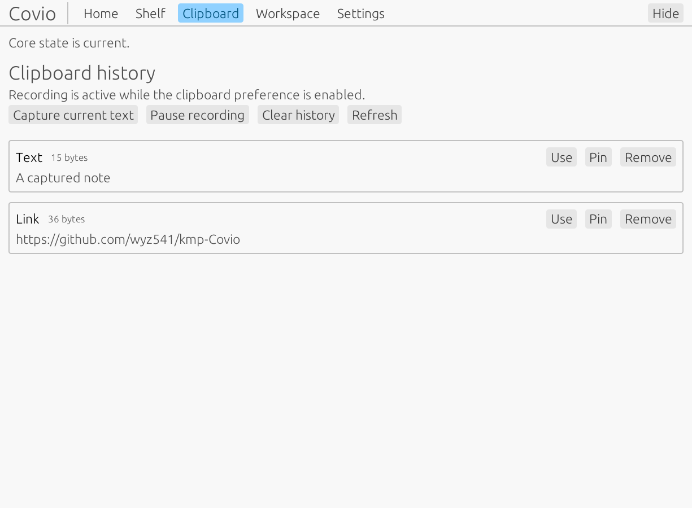

# #681 Windows 物理设备验收

## 结论

Rust + egui 的 Windows 核心路径已在物理 Windows 11 x64 设备通过自动化验收。

物理 UI 仍未完成全部手工交互验收。因此，本记录不代表 #681 已完全关闭。

睡眠和合盖控制在 Windows 当前版本明确显示为不可用。本记录只确认该状态，不把睡眠控制计为通过。

## 环境

- 验收日期：2026-11-07。
- 设备：Maxsun `Default string` 台式机，BIOS 串号不记录。
- CPU：Intel Core i5-14600KF。
- 系统：Windows 11 Enterprise，版本 `10.0.26200`，x64。
- 显示器：两块 HKC `V2719Q`。
- 显示器布局：DISPLAY1 为主屏，范围 `0,0,2560,1440`。DISPLAY2 为副屏，范围 `-2560,-60,2560,1440`。
- Windows 报告 `HypervisorPresent=true`。设备身份依据主板、CPU 和两块物理显示器记录。
- 产品提交：`3dd723a8f8447cd297901f97a80c1856d830f823`。
- 发布版本：`v0.6.0-internal.33`。
- 安装器：`Covio-0.6.0-internal.33-windows-x64-setup.exe`。
- 安装器 SHA-256：`0404981eef1a11139e8057b560fe1d18fd133c9a96c5212dcbd9cb5b9fb9f4e9`。
- 前一版本安装器：`v0.6.0-internal.32`。
- 前一版本 SHA-256：`987a3c345c848b91d1373d5de900fbd2b8705ae579ee40ae66df2a7d05f4adbf`。
- 最终安装的 `Covio.exe` SHA-256：`5ba258f5f17608d9752fd4f921ab13ccd89832600395ea89910207944119c17f`。

## 自动化结果

| 检查 | 结果 | 说明 |
| --- | --- | --- |
| `cargo fmt --check --all` | 通过 | 产品提交无格式错误。 |
| Rust 测试 | 通过 | `covio-platform` 和 `covio-windows` 全部测试通过。 |
| Clippy | 通过 | 使用 `-D warnings`。 |
| Capability smoke | 通过 | Credential Manager、剪贴板、启动项、截图目录、文件选择器请求、通知请求和更新交接通过。 |
| Single-instance smoke | 通过 | 主实例获取锁，第二实例被拒绝，锁可重新获取。 |
| Window smoke | 通过 | DPI 1.5 和窗口创建通过。 |
| Crash recovery | 通过 | 首次退出码为 23，重启 smoke 退出码为 0。 |
| Clean install | 通过 | `v0.6.0-internal.32` 安装成功。 |
| Upgrade | 通过 | `v0.6.0-internal.33` 升级成功。 |
| Rollback | 通过 | 回滚到 `v0.6.0-internal.32` 成功。 |
| Uninstall | 通过 | 卸载后 `Covio.exe` 不存在。 |
| Final restore | 通过 | 最终重新安装 `v0.6.0-internal.33`。 |
| 用户数据 | 通过 | 验收前后默认数据目录的文件名和 SHA-256 完全一致。 |
| 运行时边界 | 通过 | `Covio.exe` 运行时模块未发现 JVM、Java、Kotlin、Compose 或 JNA。 |
| 安装产物边界 | 通过 | 发布清单报告 `dependencyPackages=488`，结果为 `pass`。 |

## Windows 能力状态

- Credential Manager：读写、替换和删除通过。证据不记录密钥原文。
- 剪贴板：真实写入、读取和恢复通过。
- 启动项：注册和删除通过。
- 截图目录：本机初始没有 `Pictures\Screenshots`。创建标准目录后，能力状态变为可用。
- 文件选择器：请求校验通过。未执行手工选择文件。
- 通知：请求校验通过。未执行肉眼可见通知检查。
- 更新交接：启动 staged updater 并生成 marker，通过。
- 睡眠和合盖控制：Windows 当前报告不可用。未将此能力计为通过。

## 双显示器

窗口位于 DISPLAY2。窗口矩形为 `left=-2325`、`top=175`、`width=1243`、`height=947`。

窗口完全位于 DISPLAY2 的 `-2560,-60,2560,1440` 范围内。

双屏截图来自物理桌面。其他窗口已隐藏。

## 截图

### Workspace

| Light | Dark |
| --- | --- |
|  |  |

### Settings

| Light | Dark |
| --- | --- |
|  |  |

### Other pages

| Home | Shelf | Clipboard |
| --- | --- | --- |
|  |  |  |

## 剩余风险

- Windows 当前不支持睡眠和合盖控制。若产品需要该能力，先建立 Research Issue。
- 干净用户环境可能没有 `Pictures\Screenshots`。当前 adapter 只在目录已存在时报告可用。
- 托盘图标、通知外观和文件选择器仍需手工验收。
- 更新交接已验证。在线下载和完整升级流程未在本 Issue 中验证。