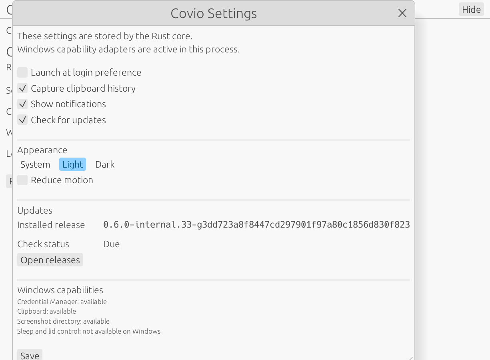
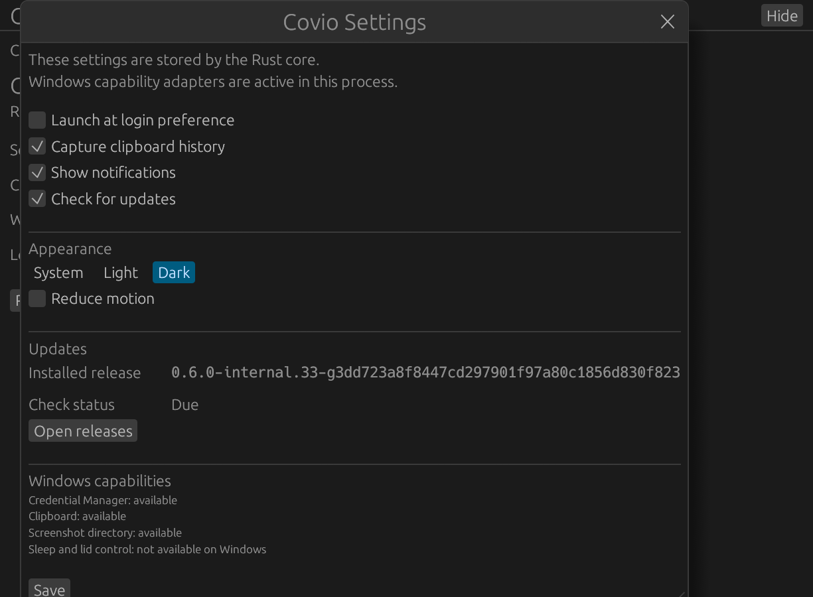
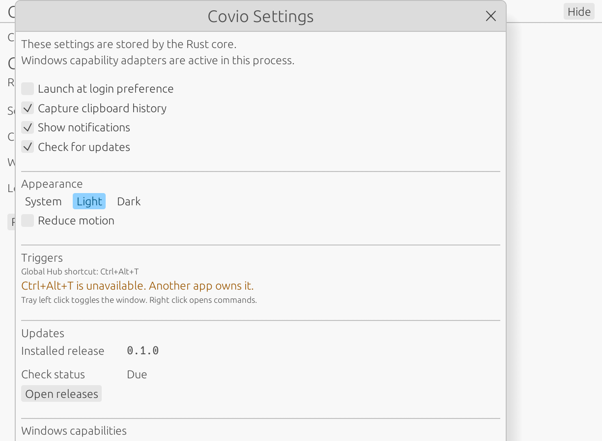
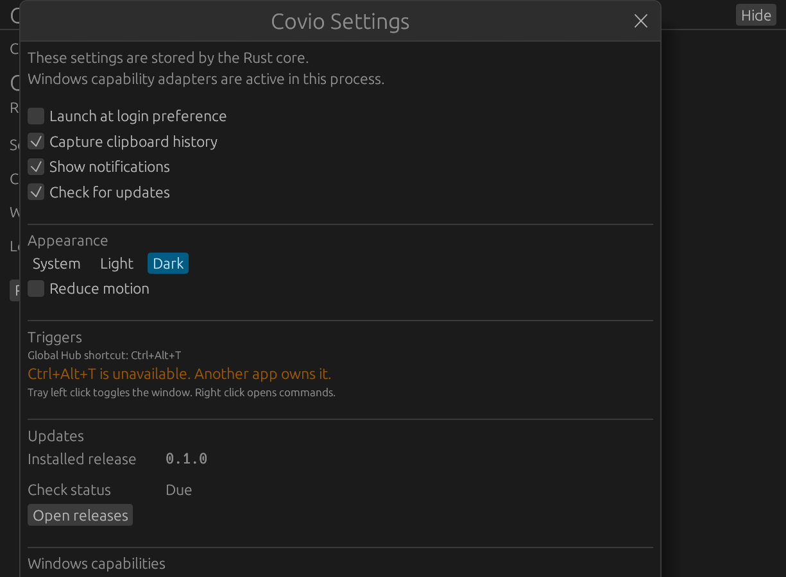

# #684 Windows trigger visual verification

## 验证信息

- 日期：2026-11-07。
- 设备：Maxsun 台式机，Intel Core i5-14600KF。
- 系统：Windows 11 Enterprise `10.0.26200`，x64。
- 显示器：两块 HKC `V2719Q`。
- 页面：Settings。
- 状态：`Ctrl+Alt+T` 被其他应用占用。
- 验证 commit：`b712139`。
- 基准 commit：`3dd723a8f8447cd297901f97a80c1856d830f823`。
- 截图来源：Windows egui host 自带截图命令，缩放 1.5。

## Before

### Light

### Dark

## After

### Light

### Dark

## 说明

After 截图验证快捷键冲突状态。

本机已有应用占用 `Ctrl+Alt+T`。Covio 保持运行，Settings 显示橙色冲突提示。

本机验证非致命冲突路径。单元测试覆盖快捷键组合和 press／release 过滤。快捷键成功注册后的真实按键路径仍需在无冲突的 Windows 设备上验收。