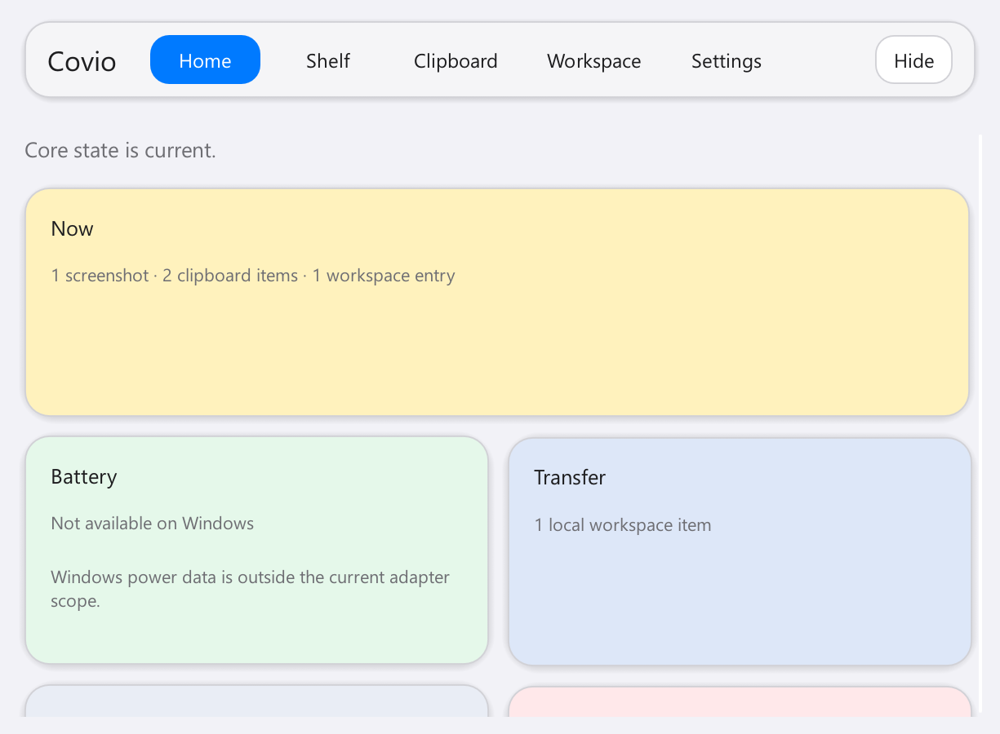
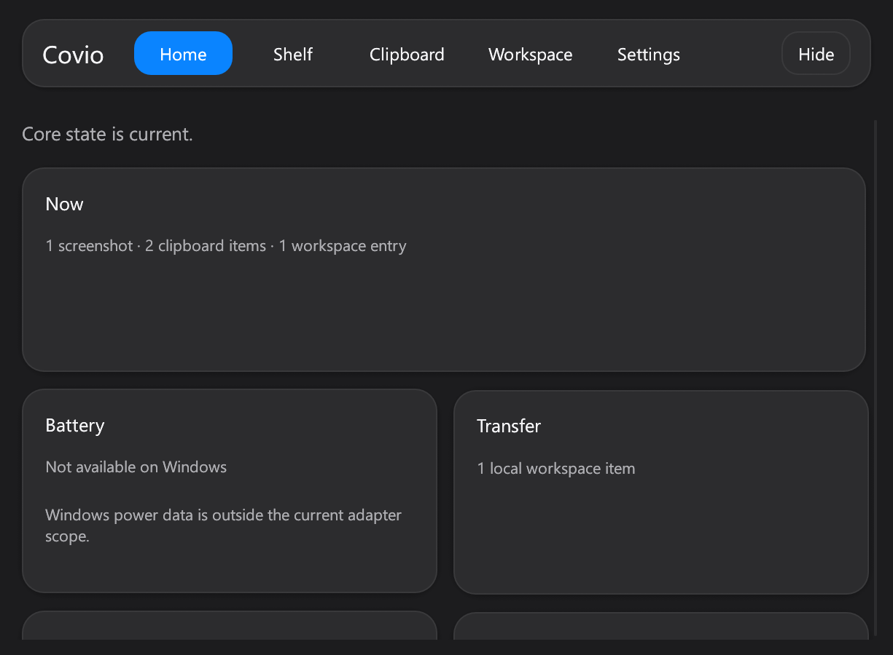
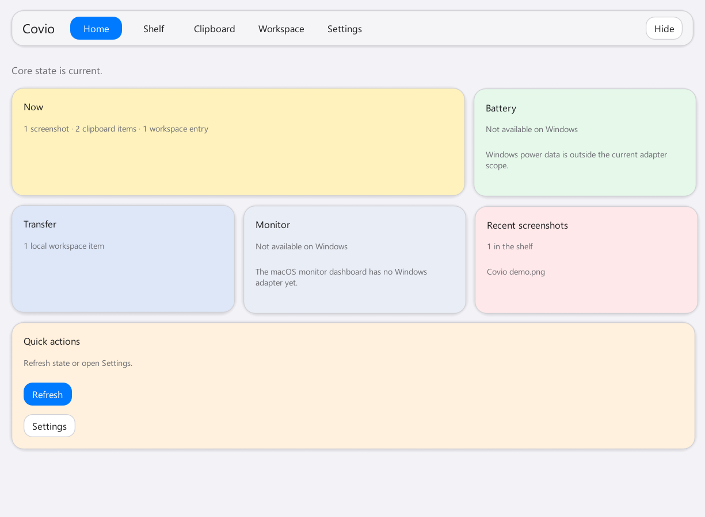

# #689 Windows Home dashboard

## 验证信息

- 日期：2026-11-07。
- 设备：Maxsun 台式机，Intel Core i5-14600KF。
- 系统：Windows 11 Enterprise `10.0.26200`，x64。
- 页面：Home。
- 状态：seed smoke data，Home 选中。
- 实现 commit：`24d8be4`。
- 150% DPI：2 列布局。
- 100% DPI：3 列布局。

## Before

| Light | Dark |
| --- | --- |
| [Home light](../690-windows-visual-foundation/home-light.png) | [Home dark](../690-windows-visual-foundation/home-dark.png) |

Before 使用一个简单计数卡。

## After

### 150% DPI

| Light | Dark |
| --- | --- |
|  |  |

### 100% DPI

## 验收结果

- Home 使用 Bento 卡片网格。
- 宽屏使用 3 列。150% DPI 使用 2 列。窄屏使用 1 列。
- Now、Battery、Transfer、Monitor、Recent screenshots 和 Quick actions 均有独立卡片。
- Windows 不支持的 Battery 和 Monitor 显示 unavailable。
- Recent screenshots 显示真实 shelf 条目。
- Quick actions 保留 Refresh 和 Settings 入口。
- 单数和复数计数文案正确。
- 150% DPI 下没有横向溢出。