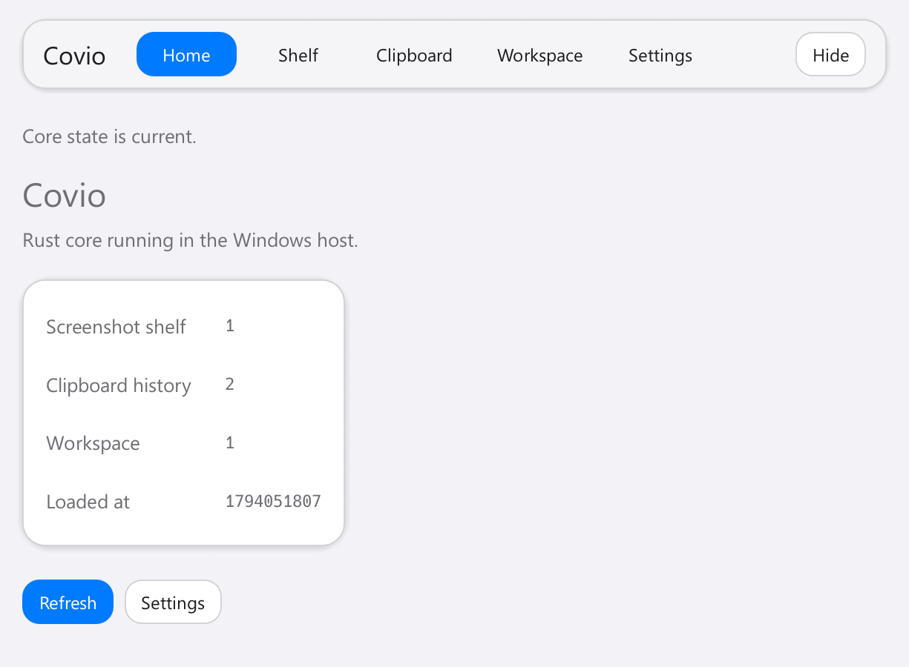
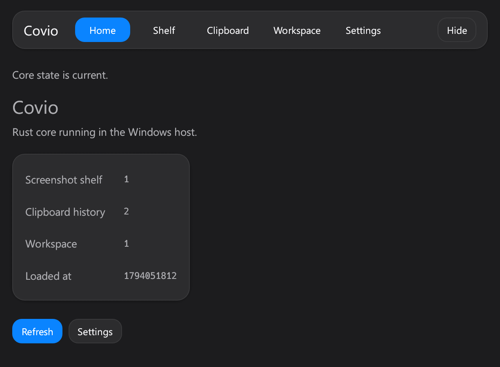
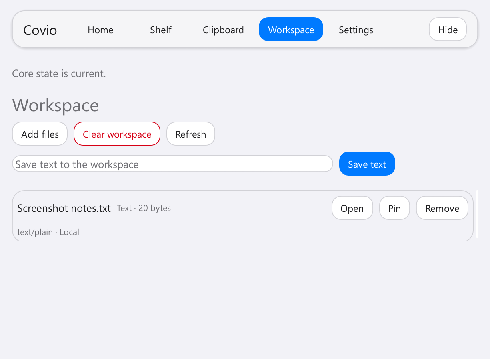
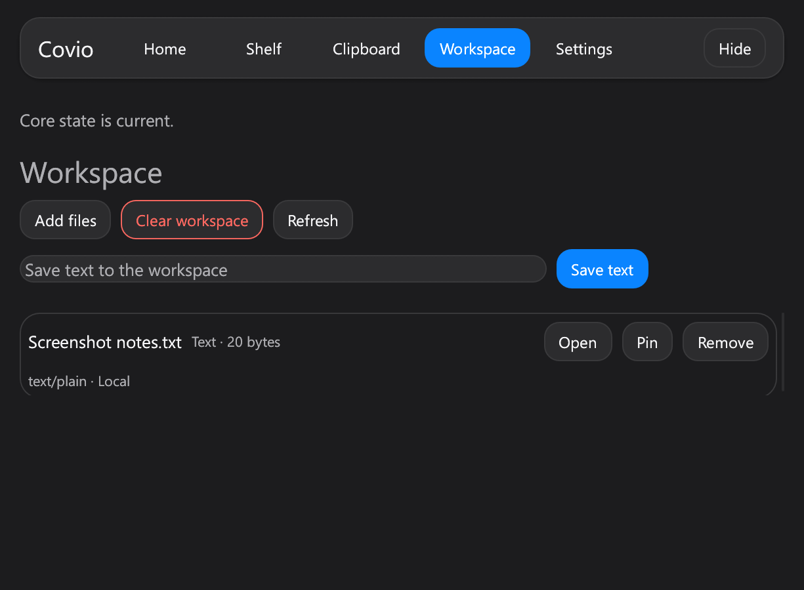
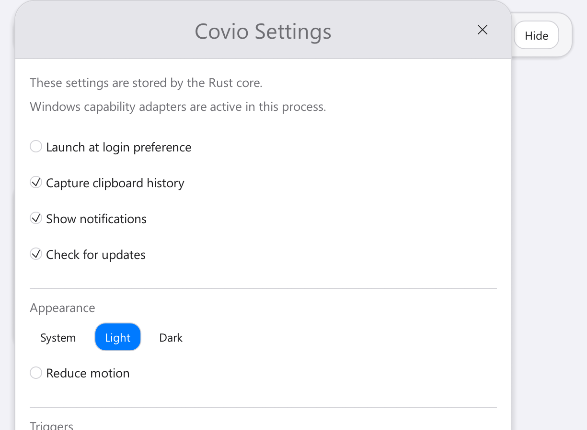
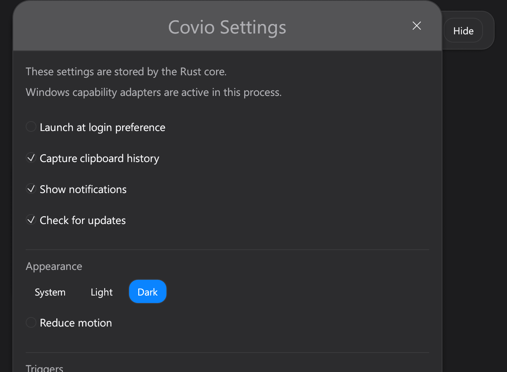

# #690 Windows visual foundation

## 验证信息

- 日期：2026-11-07。
- 设备：Maxsun 台式机，Intel Core i5-14600KF。
- 系统：Windows 11 Enterprise `10.0.26200`，x64。
- 显示器：HKC `V2719Q`，2560x1440。
- 缩放：150%。
- 实现 commit：`4c8642d`。
- 页面：Home、Workspace、Settings。
- 状态：seed smoke data，Home 和 Workspace 选中态。

## Before

- [Workspace Light](../613-workspace-light-current-1.png)
- [Workspace Dark](../613-workspace-dark-current-1.png)

Before 状态使用 egui 默认控件、默认字体和线性导航。

## After

### Home

| Light | Dark |
| --- | --- |
|  |  |

### Workspace

| Light | Dark |
| --- | --- |
|  |  |

### Settings

| Light | Dark |
| --- | --- |
|  |  |

## 验收结果

- Segoe UI 字体加载成功。
- 圆角导航和蓝色选中态生效。
- Light、Dark surface token 生效。
- 主按钮、次按钮和危险按钮层级生效。
- 页面背景和卡片表面分层生效。
- Settings 窗口继承新主题。
- 150% DPI 下没有横向溢出。

## 剩余工作

- Home 仍使用简单计数卡。由 #689 完成 Bento 网格。
- Workspace、Shelf 和 Clipboard 仍使用简单列表。由 #691 完成内容表面。
- Settings 仍使用 egui Window 外壳。由 #692 完成专用设置 shell。