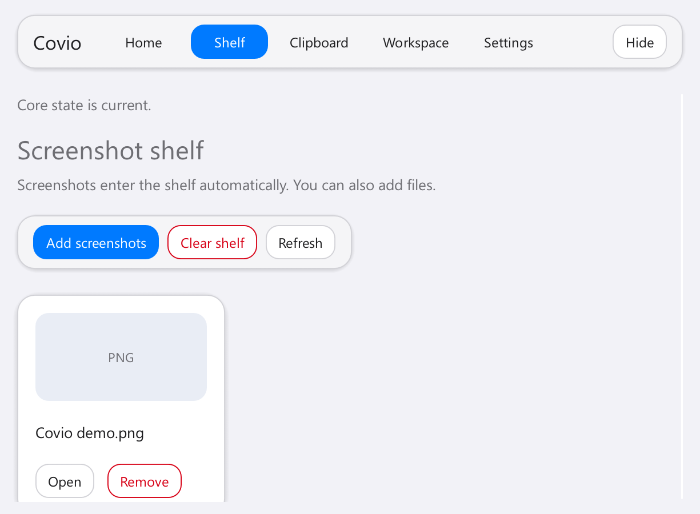
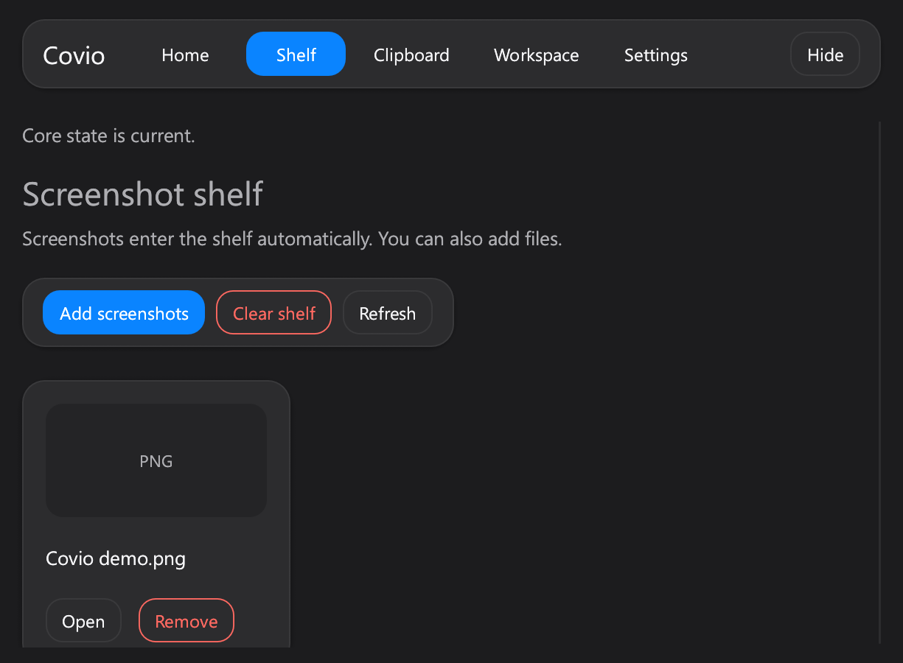
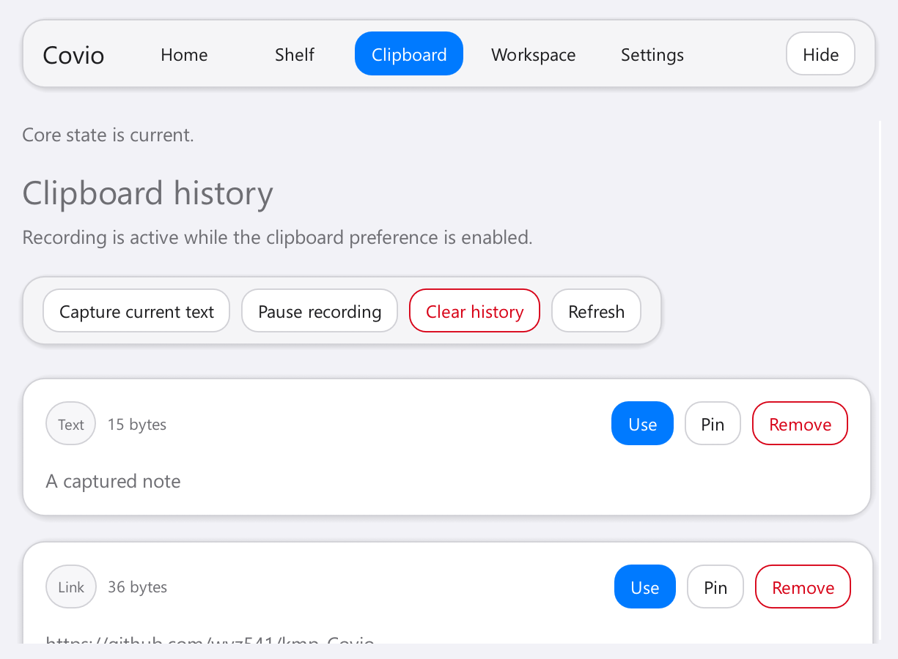
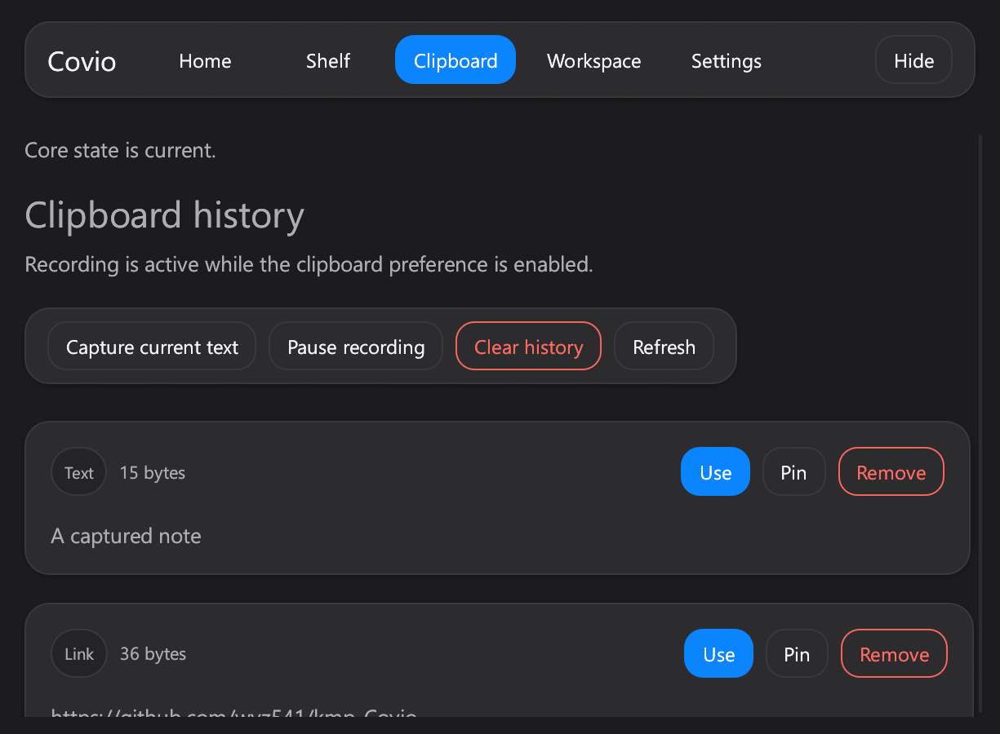
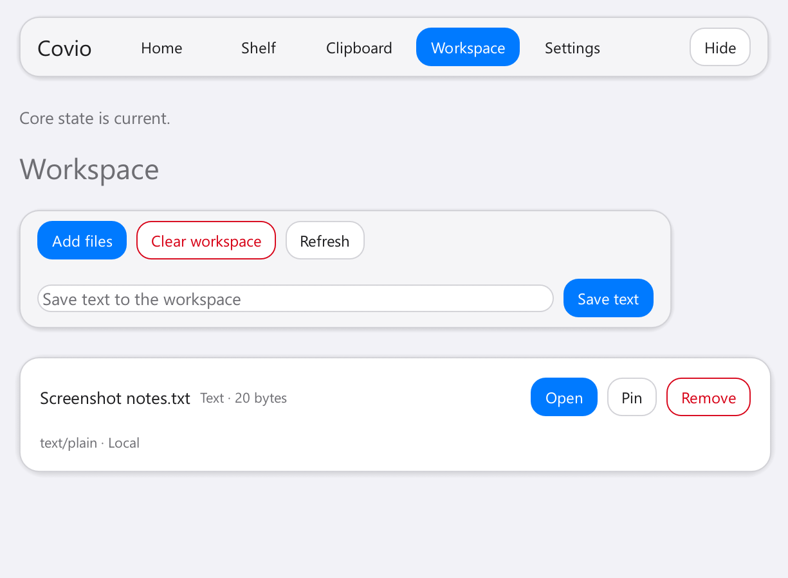
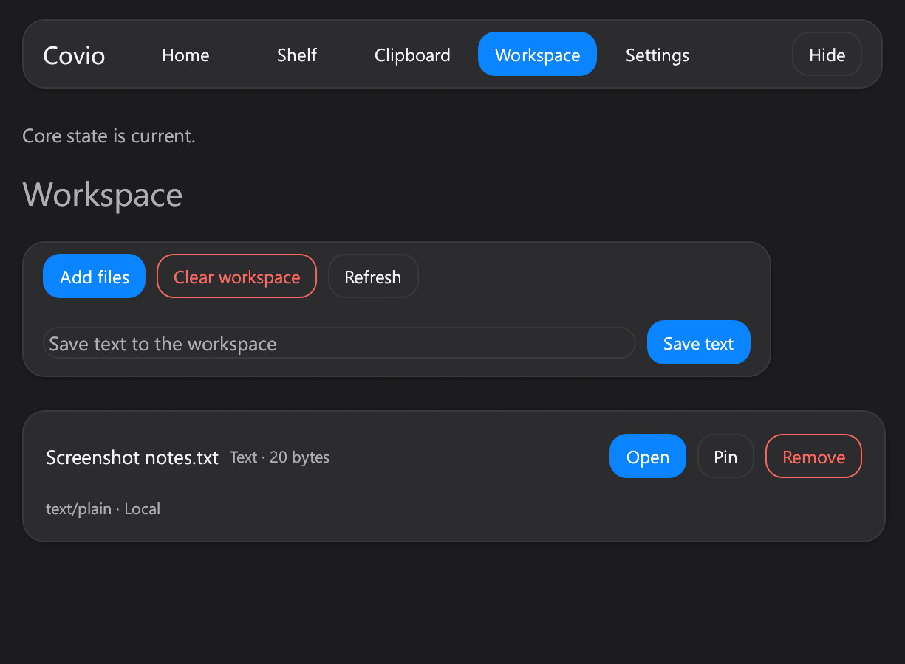
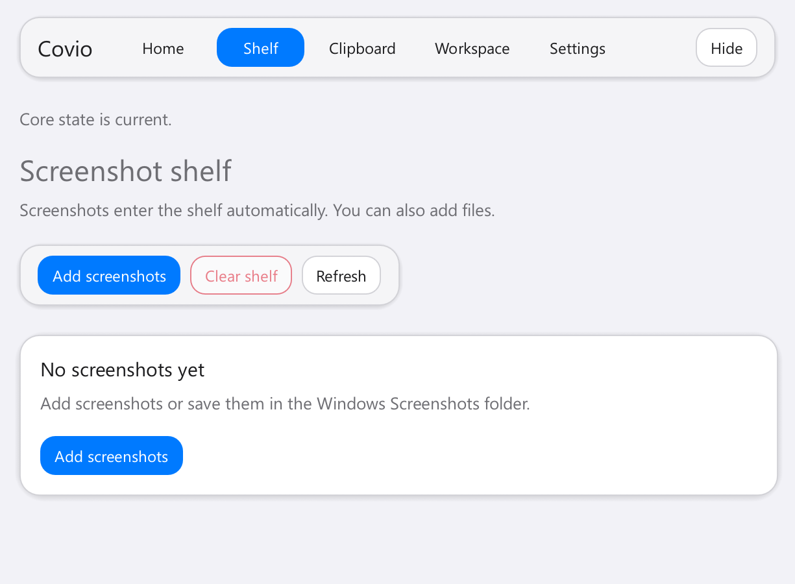
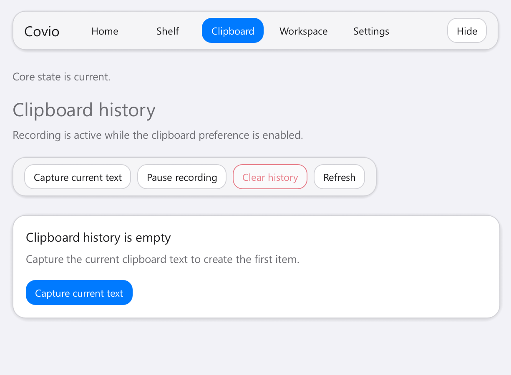
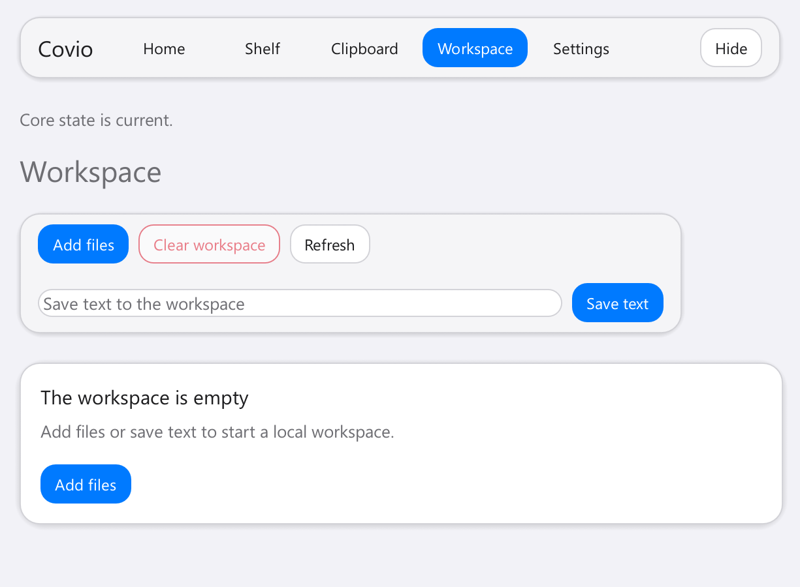

# #691 Windows content surfaces

## 验证信息

- 日期：2026-11-07。
- 设备：Maxsun 台式机，Intel Core i5-14600KF。
- 系统：Windows 11 Enterprise `10.0.26200`，x64。
- 页面：Shelf、Clipboard、Workspace。
- 缩放：150%。
- 实现 commit：`d959158`。
- 主状态：seed smoke data。
- 空状态：独立空数据目录。

## Before

| Light | Dark |
| --- | --- |
| [Workspace light](../613-workspace-light-current-1.png) | [Workspace dark](../613-workspace-dark-current-1.png) |

Before 使用裸 `ui.group` 和线性列表。

## After

### Shelf

| Light | Dark |
| --- | --- |
|  |  |

### Clipboard

| Light | Dark |
| --- | --- |
|  |  |

### Workspace

| Light | Dark |
| --- | --- |
|  |  |

### Empty states

| Shelf | Clipboard | Workspace |
| --- | --- | --- |
|  |  |  |

## 验收结果

- 三个页面使用统一 chrome toolbar。
- Shelf 使用文件卡片网格和固定预览区。
- Clipboard 使用内容类型 badge、摘要和动作层级。
- Workspace 使用全宽文件卡。
- Remove 和 Clear 使用危险动作样式。
- 空列表时禁用 Clear 动作。
- 空状态显示清晰说明和一个主行动。
- 150% DPI 下没有横向溢出。