# #692 Windows Settings shell

## 验证信息

- 日期：2026-11-07。
- 设备：Maxsun 台式机，Intel Core i5-14600KF。
- 系统：Windows 11 Enterprise `10.0.26200`，x64。
- 页面：Settings。
- 缩放：150%。窄窗口：200%。
- 实现 commit：`45dd519`。
- 状态：seed smoke data，Settings 选中。

## Before

| Light | Dark |
| --- | --- |
| [Settings light](../690-windows-visual-foundation/settings-light.png) | [Settings dark](../690-windows-visual-foundation/settings-dark.png) |

Before 使用默认 `egui::Window` 和单一纵向表单。

## After

### Overview

| Light | Dark |
| --- | --- |
| 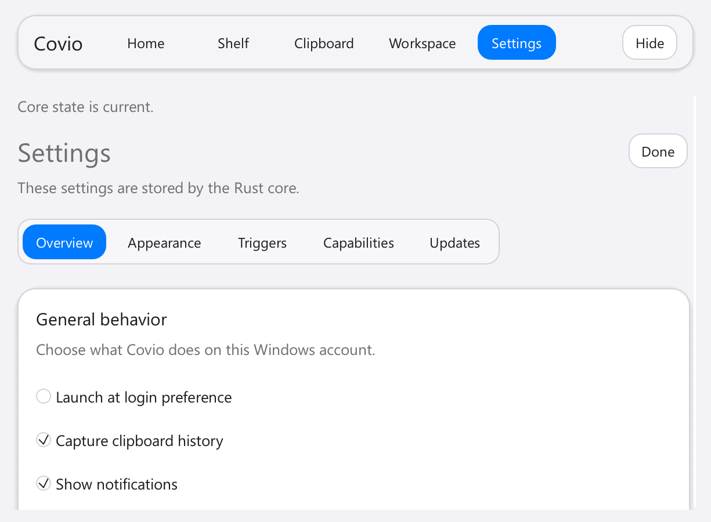 | 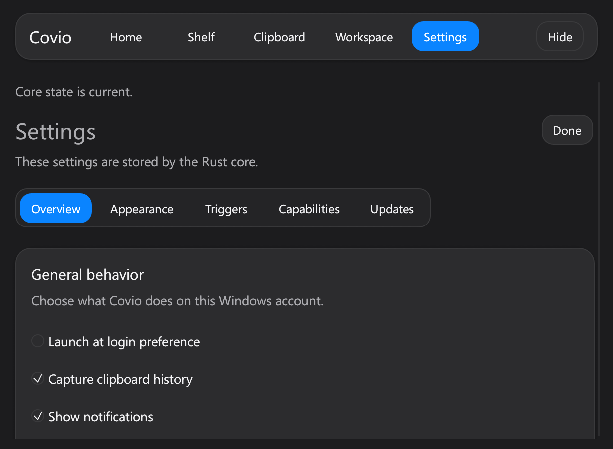 |

### Appearance

| Light | Dark |
| --- | --- |
| 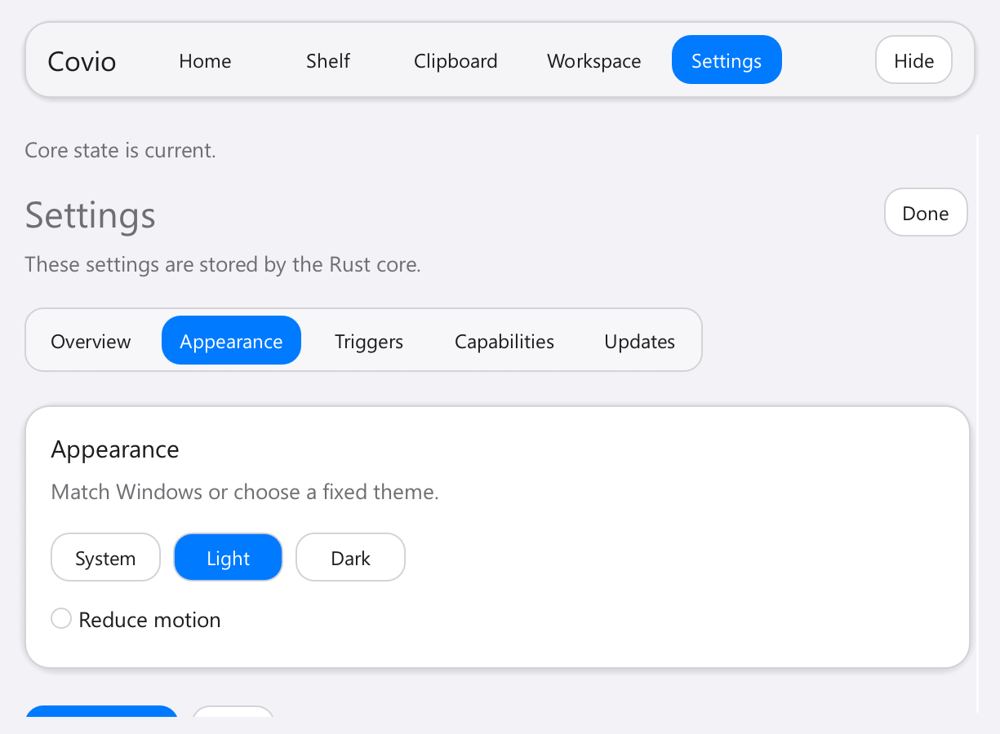 | 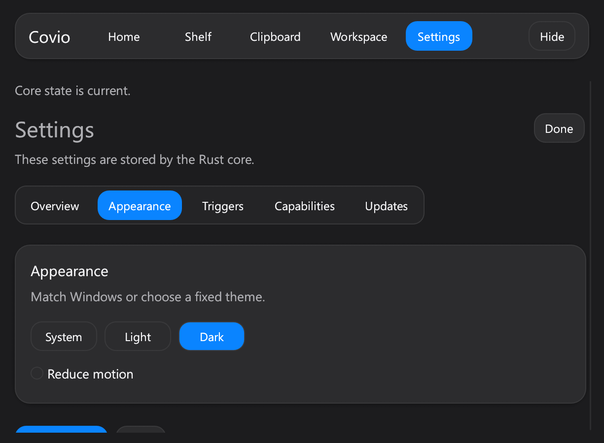 |

### Triggers

| Light | Dark |
| --- | --- |
| 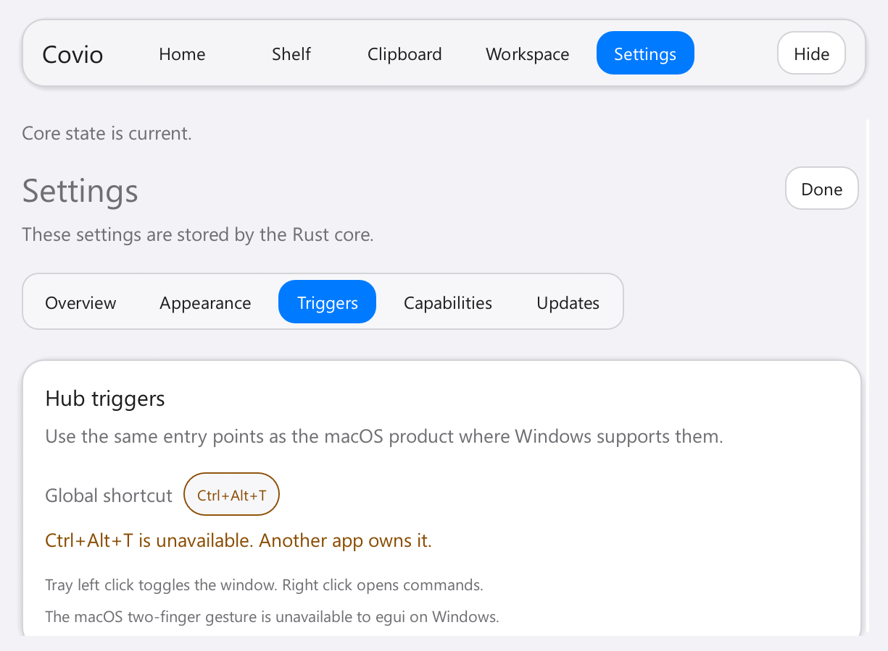 | 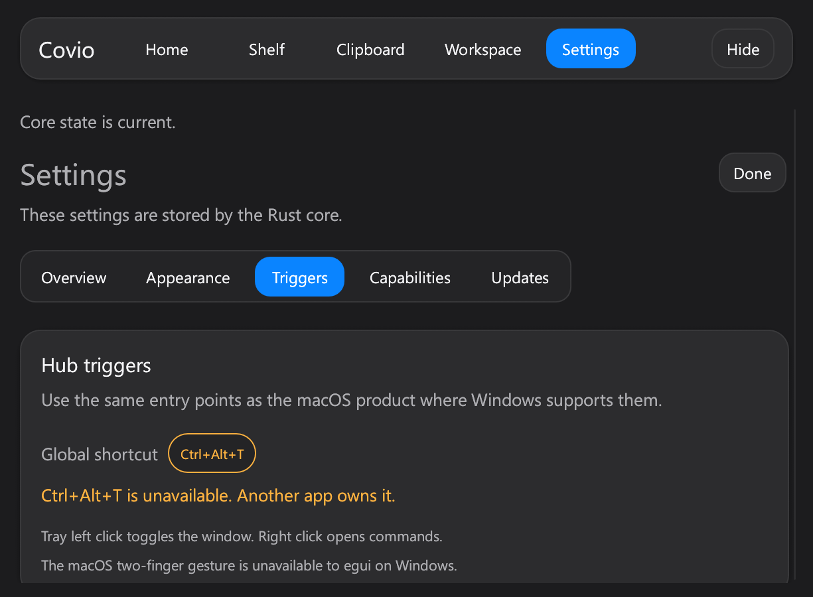 |

### Capabilities

| Light | Dark |
| --- | --- |
| 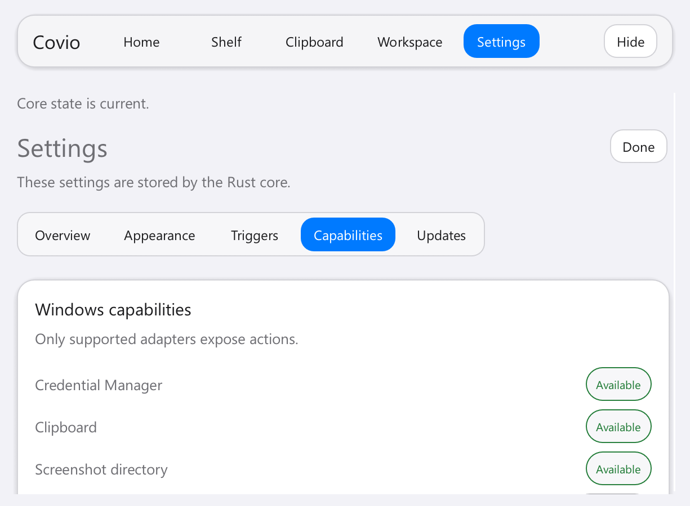 | 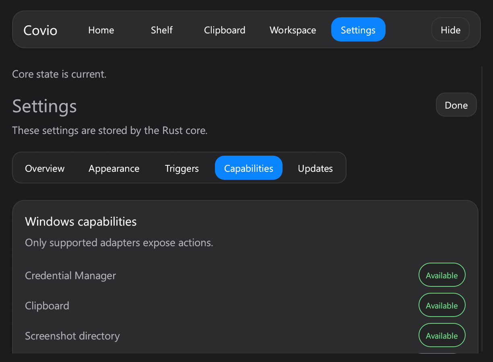 |

### Updates

| Light | Dark |
| --- | --- |
| 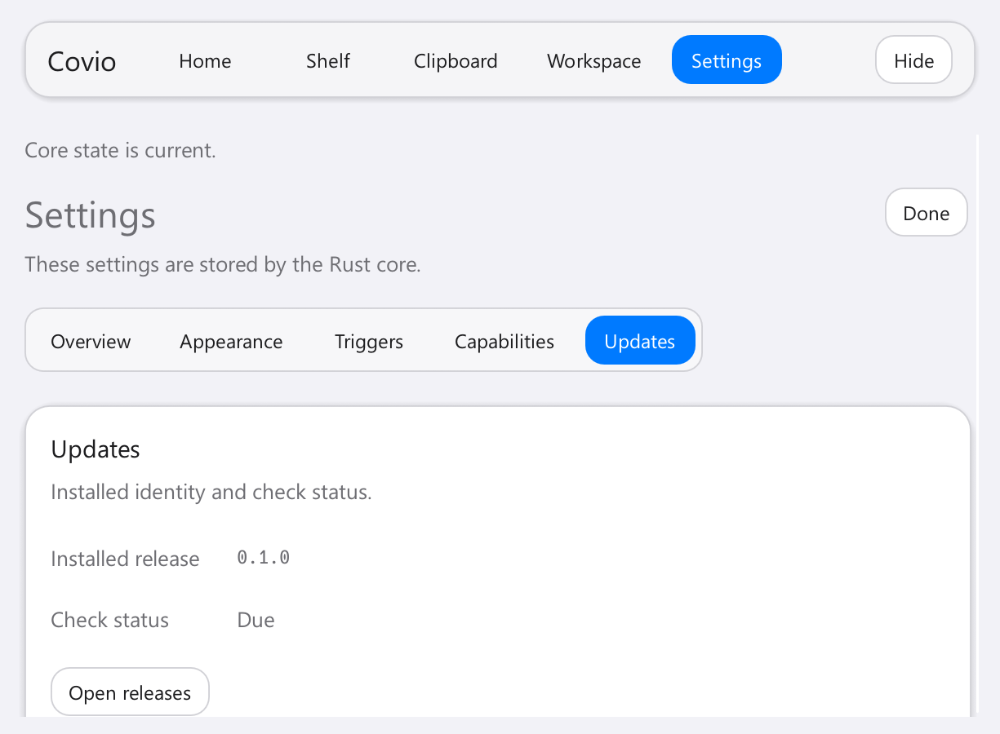 | 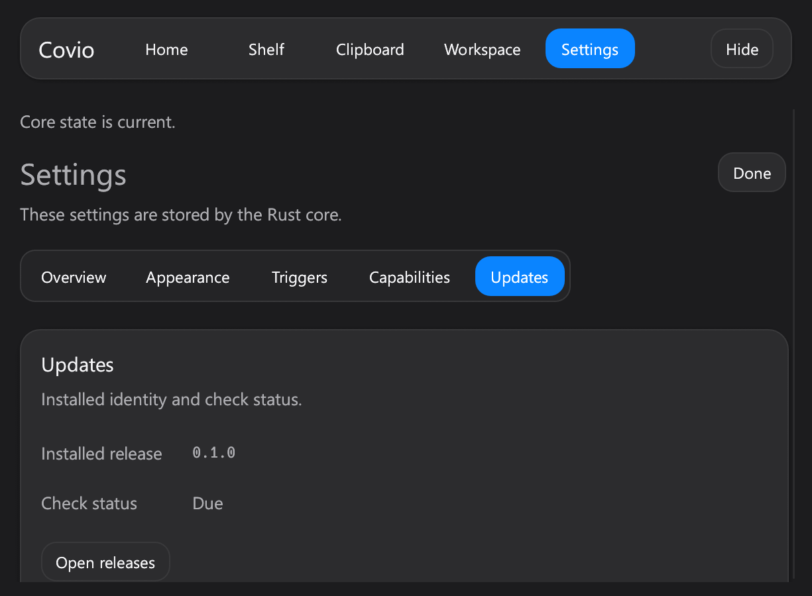 |

### Narrow window

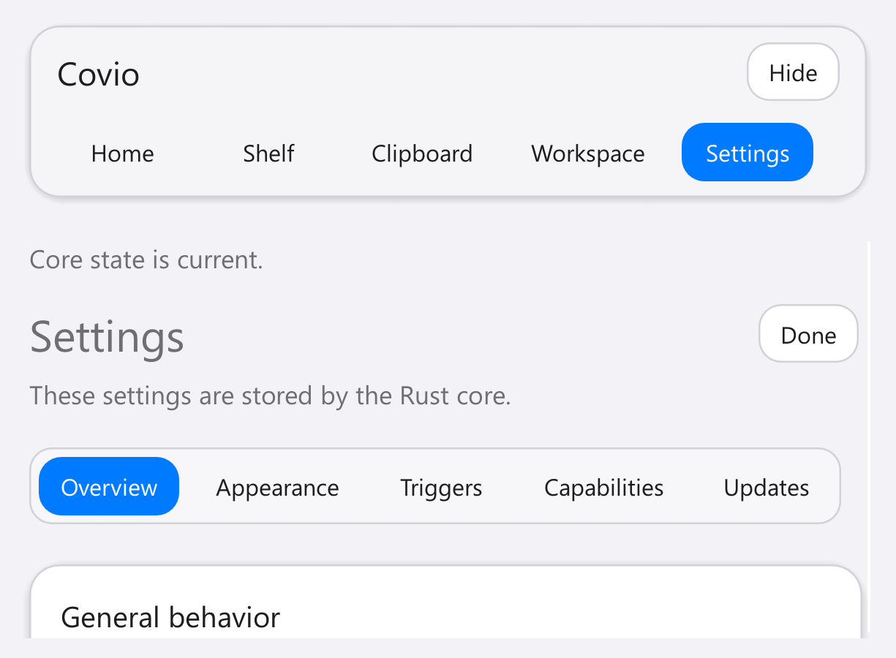

## 验收结果

- Settings 使用完整页面，不再使用默认 egui Window。
- 五个分段使用统一 segmented navigation。
- Overview、Appearance、Triggers、Capabilities 和 Updates 均有独立卡片。
- Capability 状态使用 success、warning 和 disabled token。
- Save changes 和 Done 使用共享按钮层级。
- 200% 缩放时顶部导航分成两行，Settings 和 Hide 保持可见。
- 内容可滚动，关键动作不被裁切。