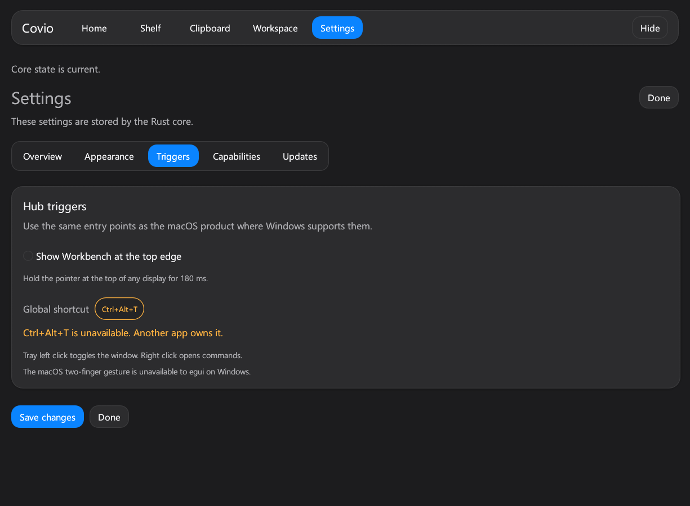
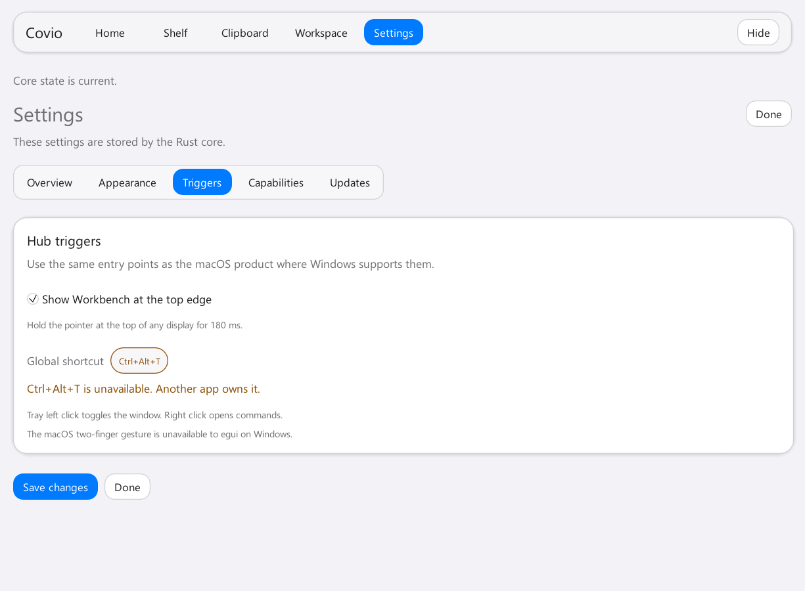
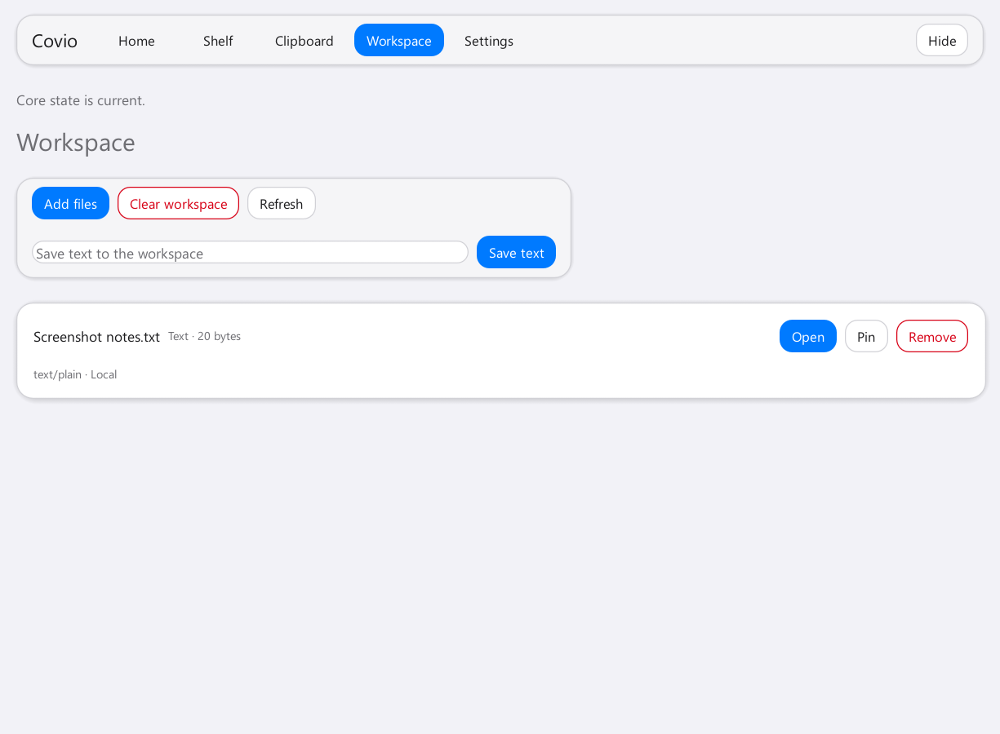

# #698 Windows 顶部边缘触发

## 验证信息

- 日期：2026-11-08。
- 设备：Maxsun 台式机，Intel Core i5-14600KF。
- 系统：Windows 11 Enterprise `10.0.26200`，x64。
- 显示器：两块 HKC `V2719Q`。
- 页面：Settings > Triggers。
- 主题：Light 和 Dark。
- 缩放：100%。
- 截图来源：Windows egui host 自带截图命令。
- 顶部触发截图：Light 主题，Workspace 页面。

## 关闭状态

| Light | Dark |
| --- | --- |
|  |  |

## 开启状态

| Light | Dark |
| --- | --- |
|  |  |

## 顶部触发结果

## 运行验证

- 使用 `--background` 启动应用。
- 检查 `IsWindowVisible`。结果为 `false`。
- 使用 `SetCursorPos` 把鼠标移到主显示器顶部。
- 检查 `IsWindowVisible`。结果为 `true`。
- 再等待 500 ms。窗口保持可见。
- 触发后检查页面。页面保持为 Workspace。
- 测试结束后恢复鼠标位置。
- 测试使用进程 ID 精确关闭应用。

## 验收结果

- Settings 显示顶部触发开关。
- 开关默认关闭。
- 开关状态保存到 Windows 用户数据目录。
- 任一显示器的顶部 2 像素区域可触发。
- 鼠标停留 180 ms 后显示 Workbench。
- 窗口可见时不触发切换。
- 显示后鼠标必须离开顶部区域才可再次触发。
- 700 ms 冷却时间阻止连续弹出。