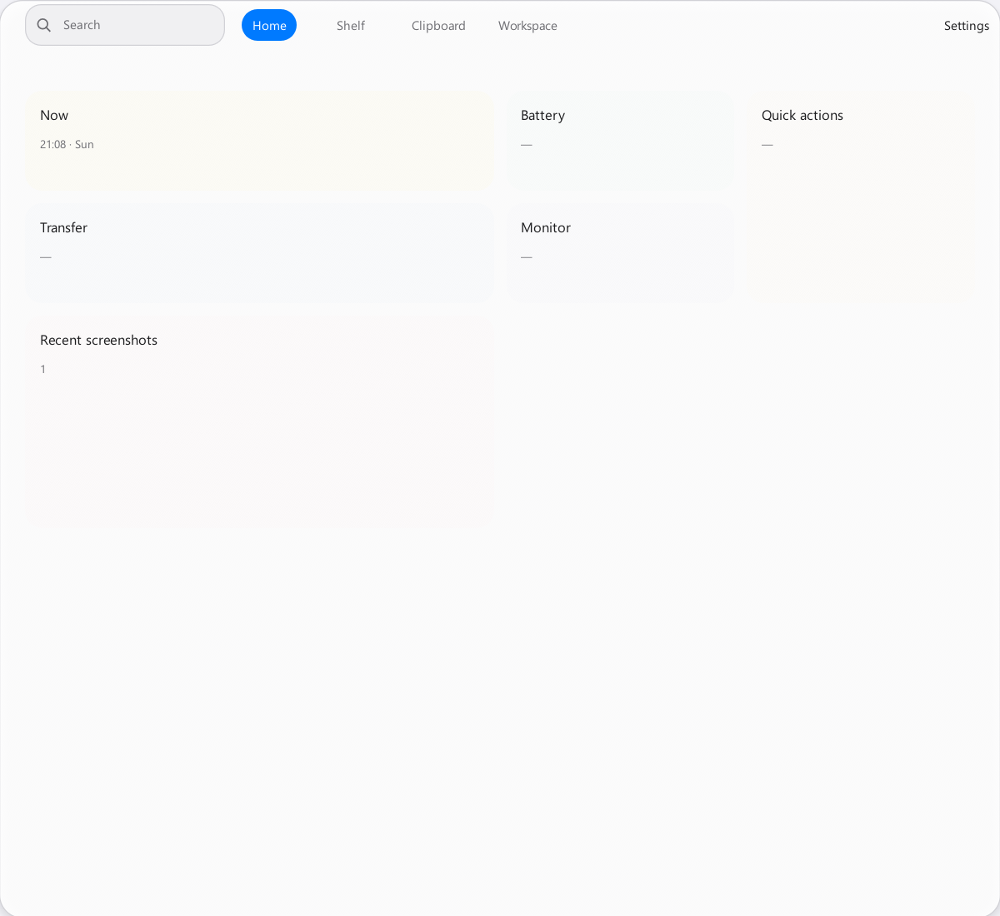
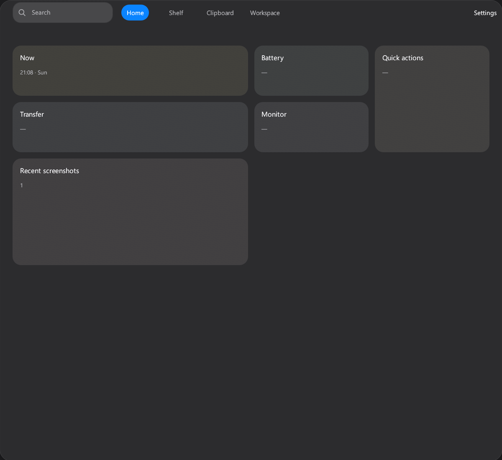

# #702 Windows 顶部悬浮 Workbench

## 验证信息

- 日期：2026-11-08。
- 设备：Maxsun 台式机，Intel Core i5-14600KF。
- 系统：Windows 11 Enterprise `10.0.26200`，x64。
- 显示器：HKC `V2719Q`。
- 主显示器：2560 × 1440。缩放为 125%。
- 页面：Workbench Home。
- 主题：Light 和 Dark。
- 截图来源：Windows egui host 自带截图命令。
- 截图不包含桌面内容。

## 顶部悬浮表现

| Light | Dark |
| --- | --- |
|  |  |

## 原生窗口验证

测试数据目录启用顶部触发。

测试启动应用时使用无参数模式。

测试结果如下：

- 启动后窗口不可见。
- 鼠标到达主显示器顶部后，窗口可见。
- 原生物理矩形为 `Left=680, Top=0, Width=1200, Height=1100`。
- 工作区逻辑尺寸为 `960 × 880`。
- 窗口水平居中。窗口上边界等于显示器上边界。
- `WS_CAPTION` 未设置。
- `WS_EX_APPWINDOW` 未设置。
- `WS_EX_TOOLWINDOW` 已设置。
- `WS_EX_TOPMOST` 已设置。
- 鼠标离开窗口后，窗口在 500 ms 后不可见。
- 鼠标回到屏幕顶部后，窗口再次可见。
- 再次显示后，窗口矩形和扩展样式保持不变。
- Settings 页面显示后，鼠标离开窗口 1200 ms，窗口仍保持可见。

## 自动验证

以下命令通过：

- `cargo test -p covio-platform -p covio-windows --all-targets`
- `cargo clippy -p covio-platform -p covio-windows --all-targets -- -D warnings`
- `cargo build -p covio-windows`
- `scripts/test-windows-rust.sh`

## 验收结果

- 正常启动不显示普通窗口。
- 顶部触发显示无边框 Workbench。
- Workbench 与 macOS 视觉基准保持一致。
- Workbench 不显示任务栏按钮。
- Workbench 保持置顶。
- Workbench 自动隐藏。
- Settings 页面关闭自动隐藏。
