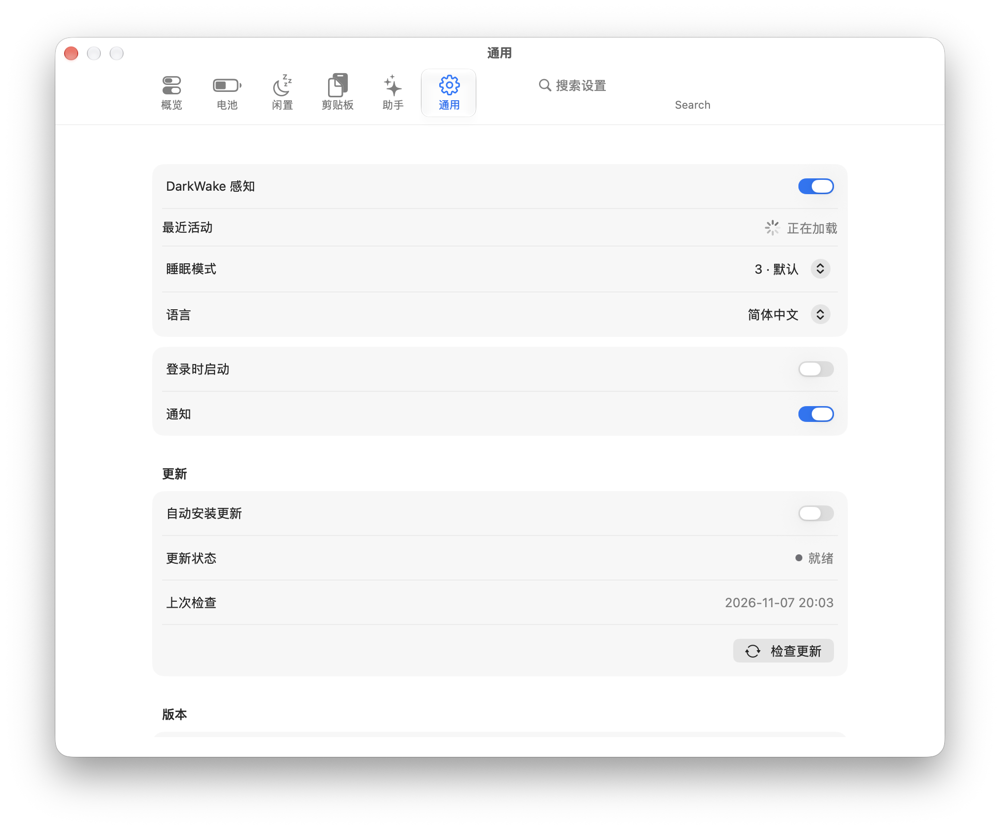
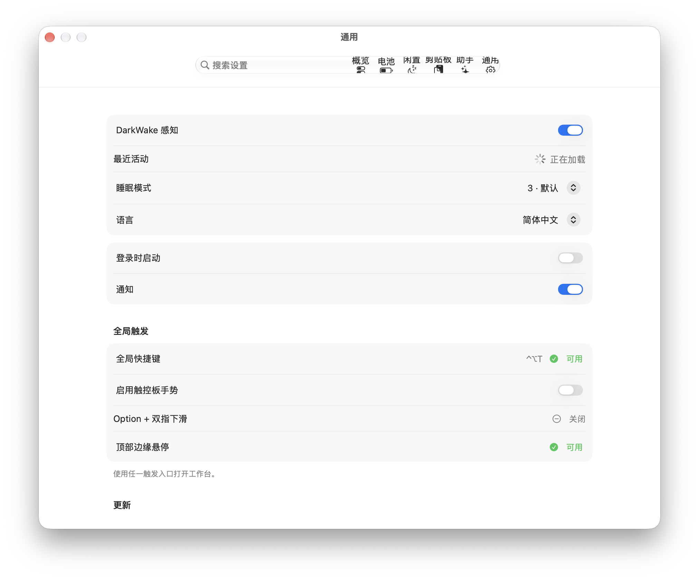
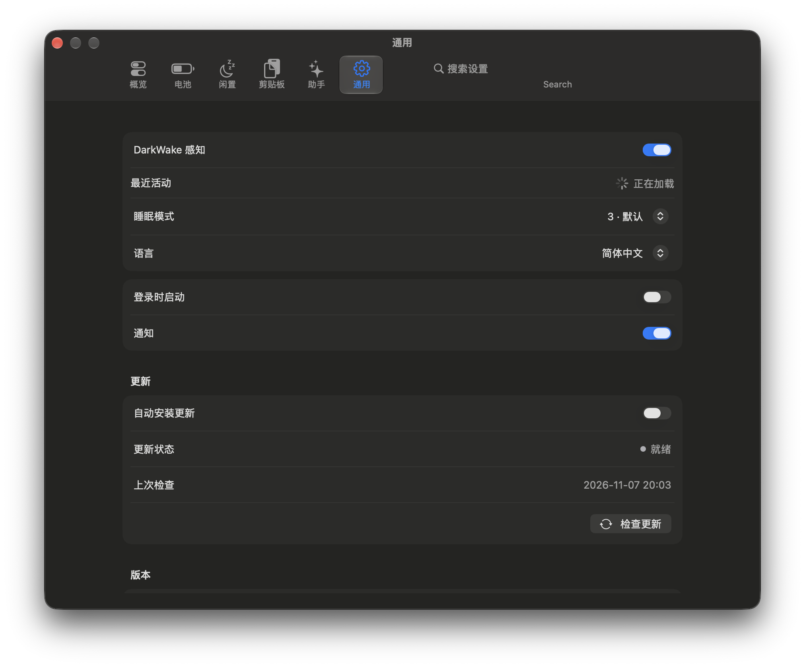
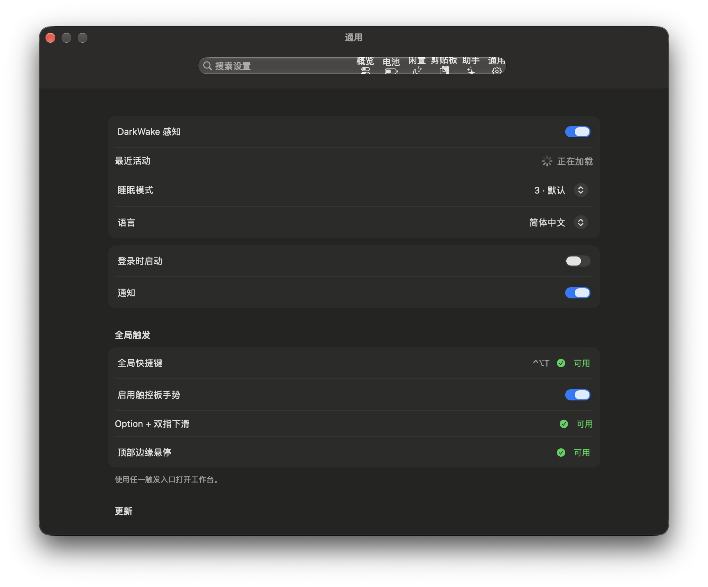
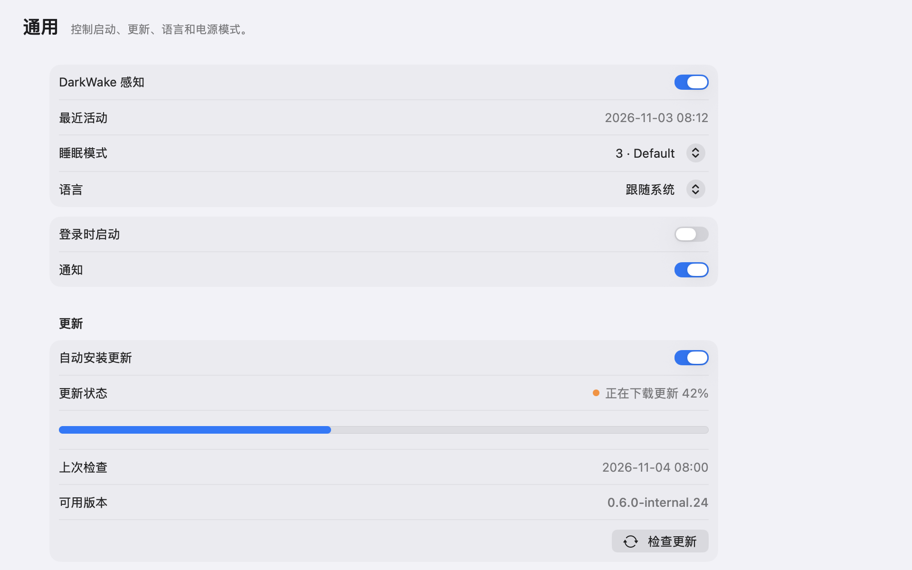
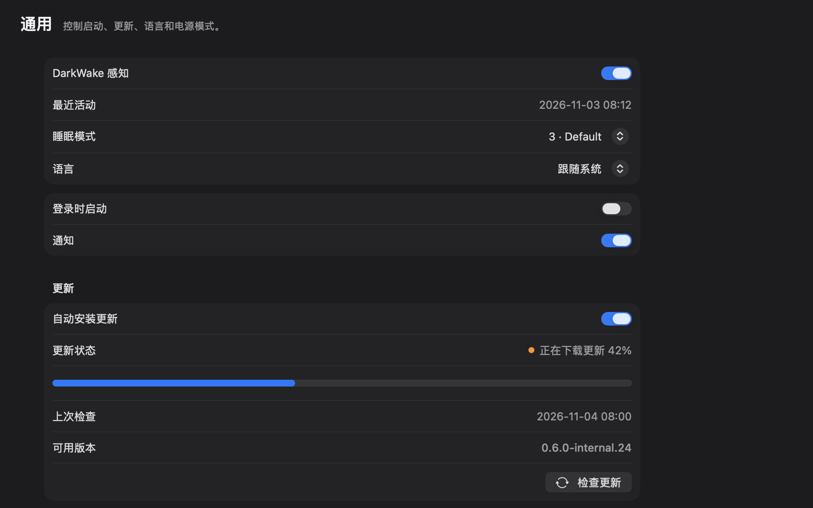

# #703 更新进度与全局触发设置

## 验证信息

- 日期：2026-11-08
- 设备：MacBook Pro
- 系统：macOS 27.0.1
- 页面：Settings > 通用
- 主题：Light 和 Dark
- 功能提交：`9137c00`
- 验收修复：`1519f55`
- 截图来源：Debug 构建的真实 Settings 窗口和 `SettingsUpdatePreviewRenderer`

## 通用页

关闭触控板手势时，页面显示全局快捷键、关闭状态和顶部边缘悬停状态。
同时确认工具栏只有一个原生搜索框，没有重复的 `Search` 标签。

| Before Light | After Light |
| --- | --- |
|  |  |

| Before Dark | After Dark |
| --- | --- |
|  |  |

## 下载进度

下载状态显示 `42%` 和线性进度条。

| Light | Dark |
| --- | --- |
|  |  |

## 自动化验证

`bash scripts/test-all.sh` 通过。
macOS XCTest 执行 1104 项，跳过 3 项，失败 0 项。
