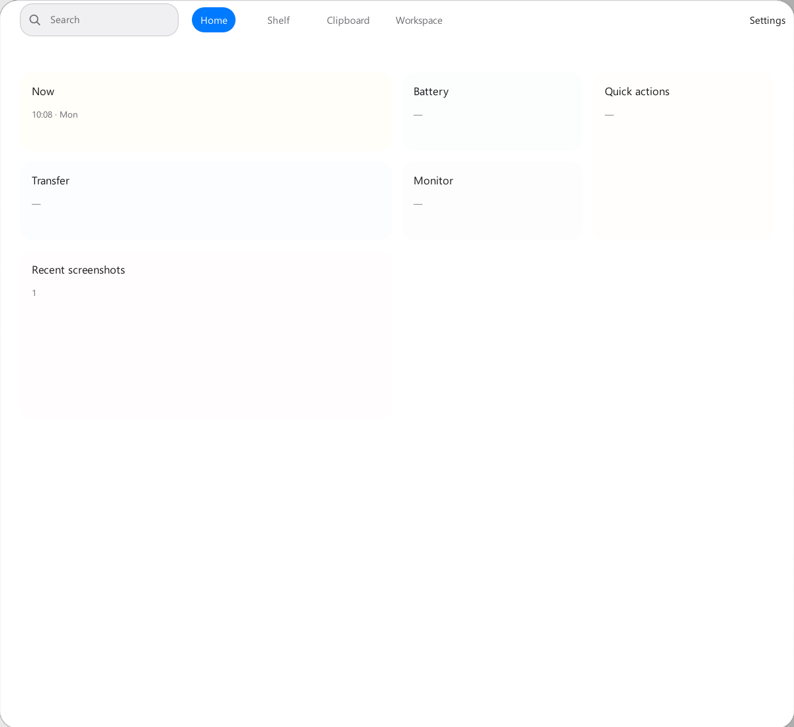
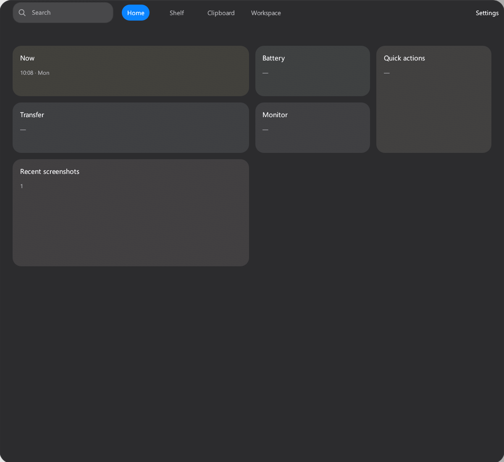

# #708 Windows Workbench 圆角裁剪

## 验证信息

- 日期：2026-11-09。
- 设备：Maxsun 台式机，Intel Core i5-14600KF。
- 系统：Windows 11 Enterprise `10.0.26200`，x64。
- 显示器：HKC `V2719Q`。
- 主显示器：2560 × 1440。缩放为 125%。
- 页面：Workbench Home。
- 主题：Light 和 Dark。

## 视觉证据

| Light | Dark |
| --- | --- |
|  |  |

截图来自 Windows egui host 的 RGBA 截图。

棋盘格只表示透明像素。

## 透明角验证

- Light 截图尺寸为 `1200 × 1100`。
- Dark 截图尺寸为 `1200 × 1100`。
- Light 四角像素的 alpha 为 0。
- Dark 四角像素的 alpha 为 0。
- Light 中心像素的 alpha 为 255。
- Dark 中心像素的 alpha 为 255。
- Workbench 外框不再绘制阴影。
- 卡片和控件的内部阴影保留。

## 原生窗口验证

- 窗口矩形为 `Left=680, Top=0, Width=1200, Height=1100`。
- 窗口区域按 125% DPI 使用圆角裁剪。
- DWM 非客户区渲染状态为关闭。
- DWM 扩展边框与窗口矩形相同。
- 原生屏幕截图确认四角显示桌面背景。
- 原生屏幕截图确认窗口外侧没有可见阴影。

## 自动验证

以下命令通过：

- `cargo test -p covio-platform -p covio-windows --all-targets`
- `cargo clippy -p covio-platform -p covio-windows --all-targets -- -D warnings`
- `cargo build -p covio-windows`
- `scripts/test-windows-rust.sh`
- `scripts/test-rust.sh`

## 验收结果

- Workbench 四角透明。
- Workbench 外框无阴影。
- 圆角半径随 DPI 缩放。
- 窗口尺寸变化后，圆角区域重新应用。
- Settings 使用相同的外框圆角和无阴影规则。
