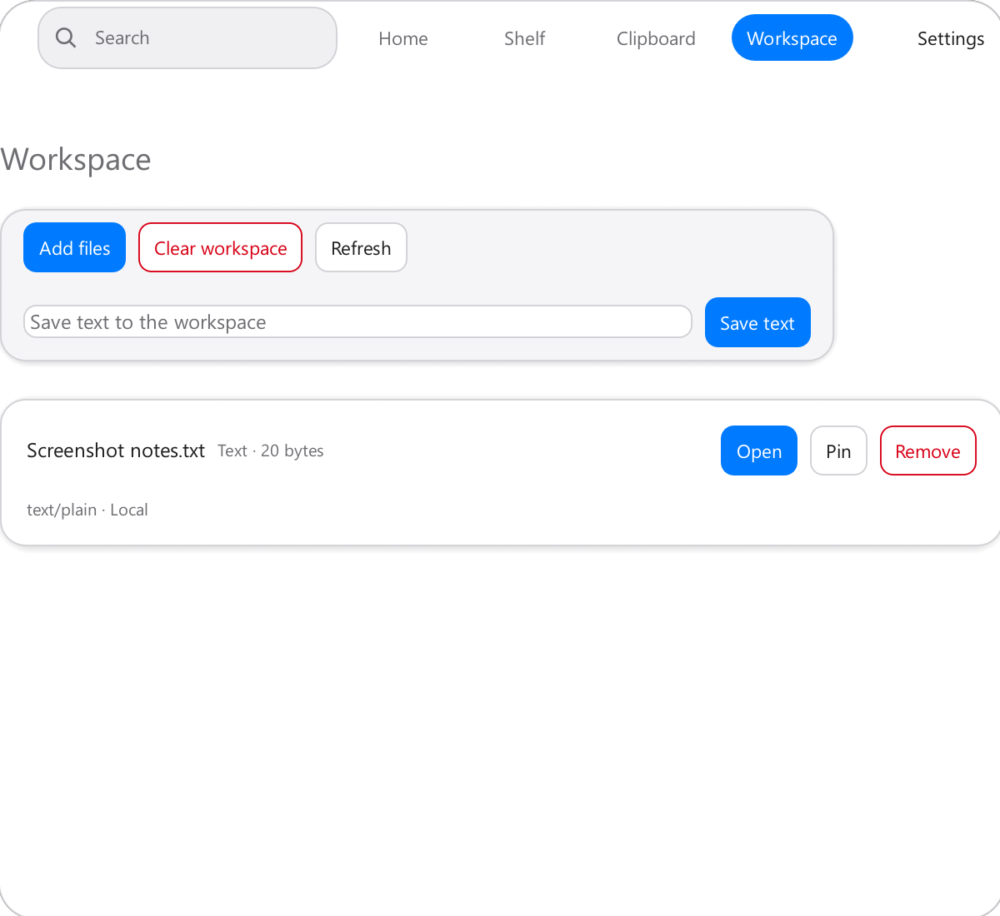
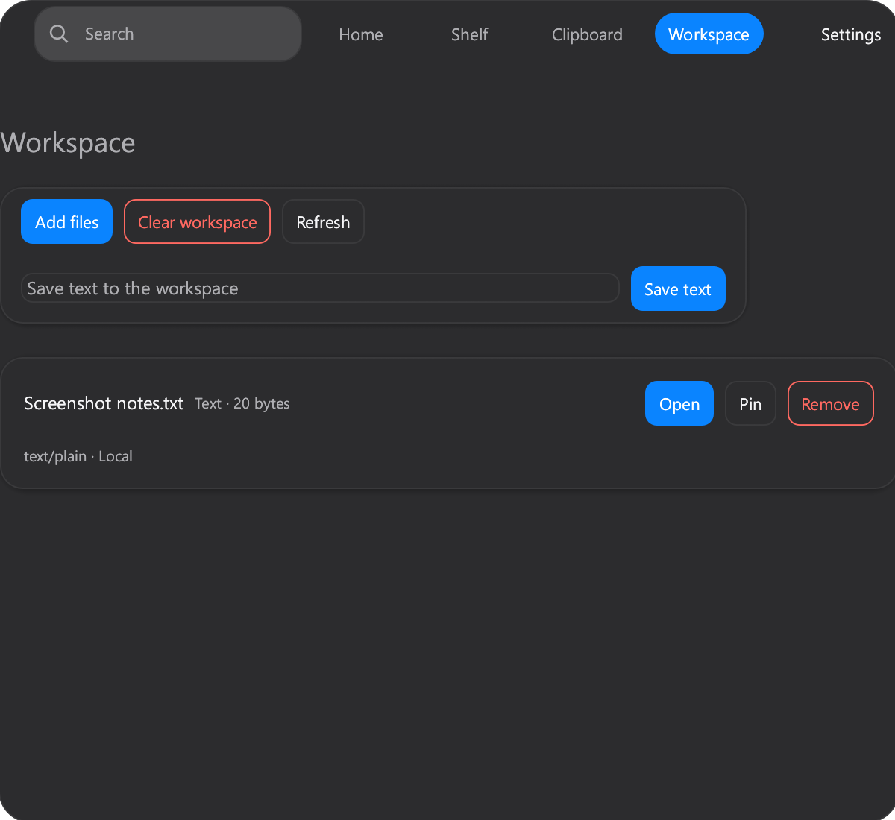

# #719 Windows contract parity

- 日期：2026-11-09
- 系统：Windows 10.0.26200
- UI 缩放：1.5
- 页面：Workspace
- 状态：seed-smoke-data
- 代码提交：`d131cf9`

## Light

| Before | After |
| --- | --- |
|  |  |

## Dark

| Before | After |
| --- | --- |
|  |  |

## 结果

- Before 使用 22 点面板圆角。
- After 使用合同 `geometry.panelCornerRadiusPoints` 的 23 点。
- 四角裁剪完整。
- 外框没有阴影。
- 卡片和控件没有出现缩放或布局回归。
