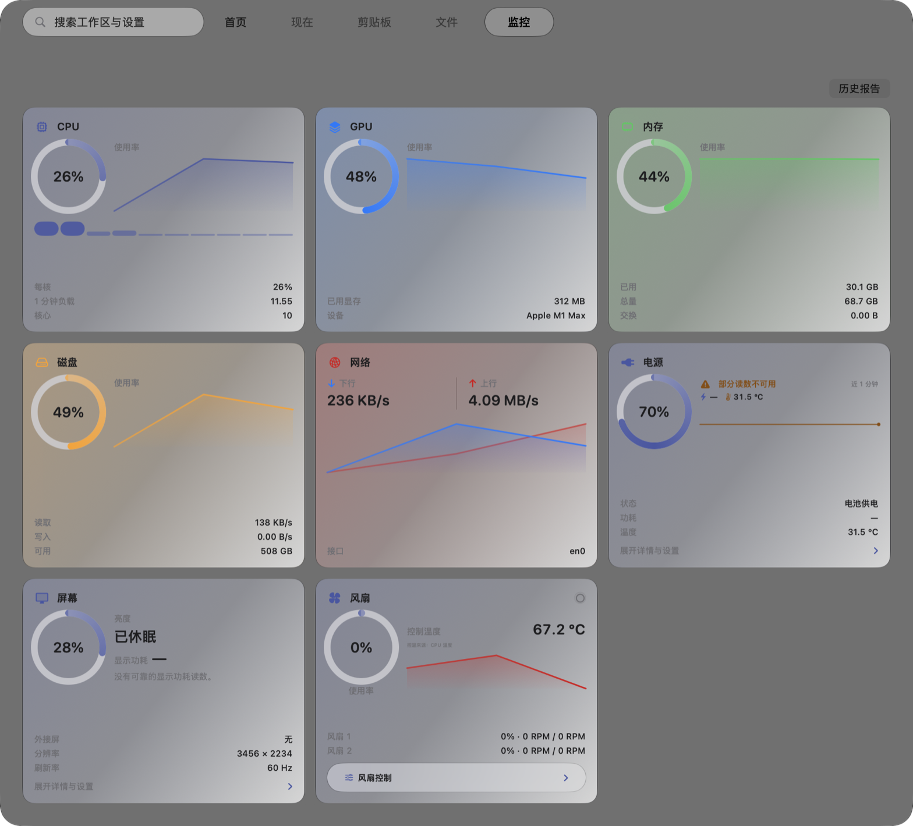
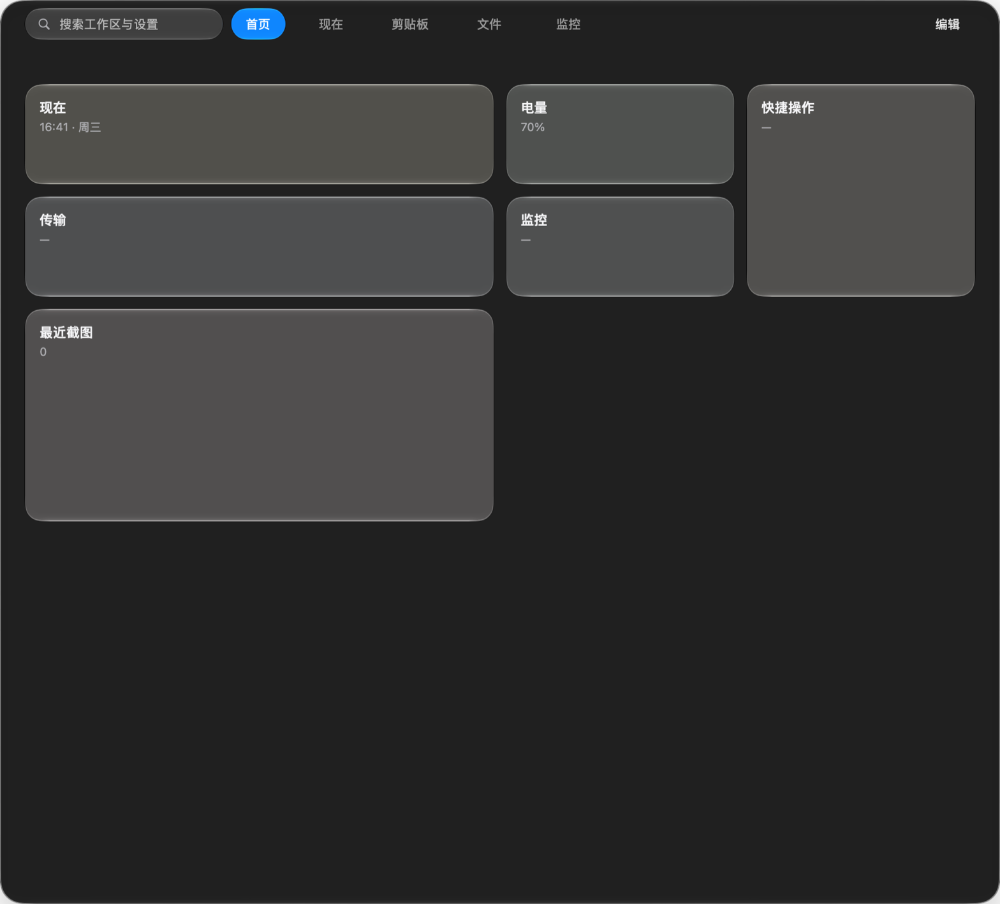
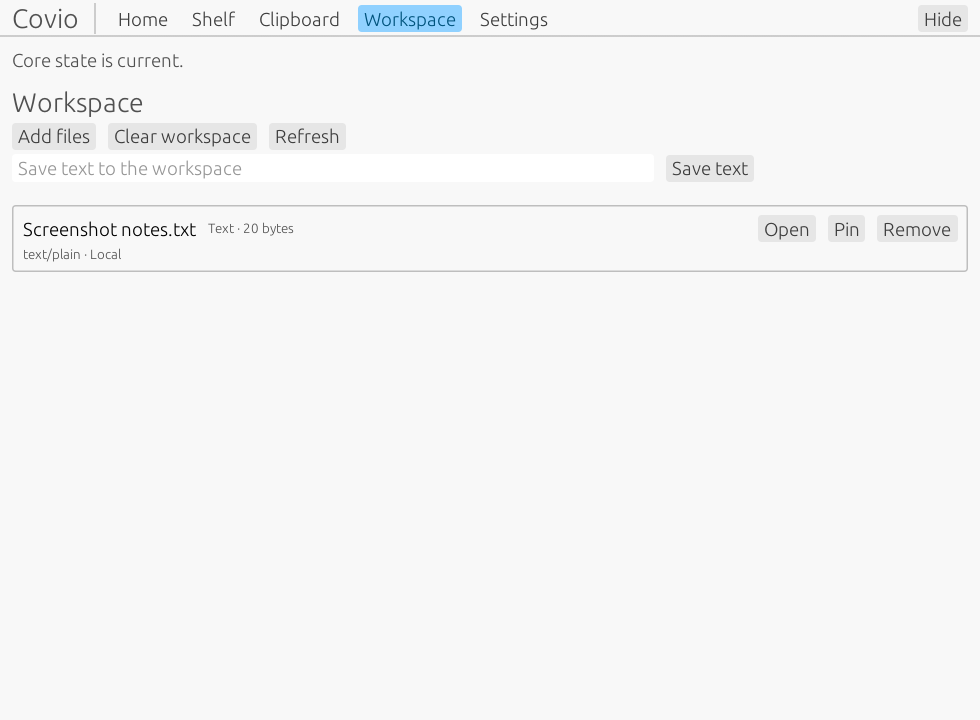
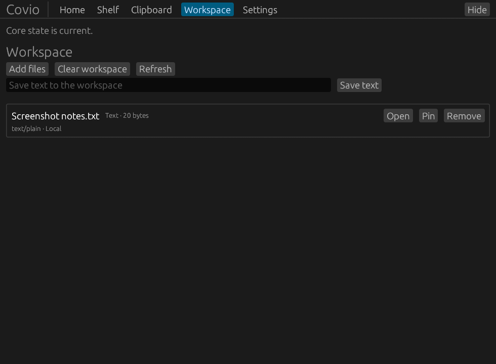
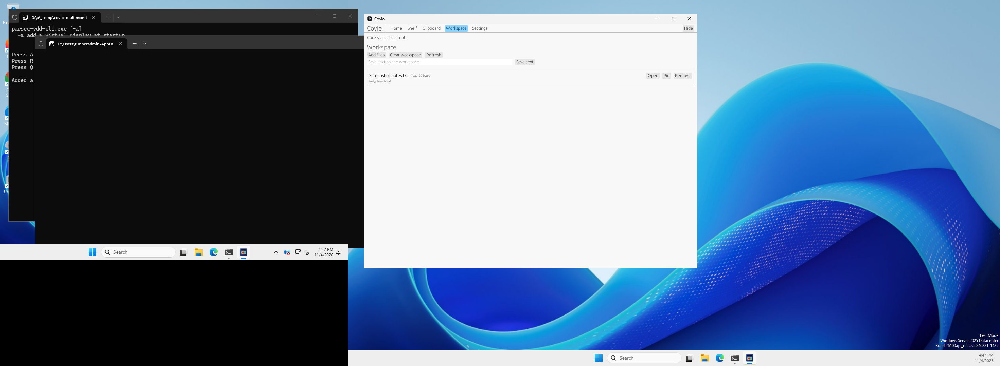

# Covio Windows 与 macOS Rust core 迁移计划

- 状态：accepted
- 日期：2026-11-04
- 决策：[ADR-0030](../adr/adr-0030-rust-core-platform-native-ui.md)
- Feature：[#595](https://github.com/wyz541/kmp-Covio/issues/595)

## 1. 结论

本次迁移只覆盖 Windows 和 macOS。
Windows 使用 Rust + egui。
macOS 使用 SwiftUI + AppKit。
Android、iOS 和 Web 不在本次迁移范围内。

Windows 和 macOS 迁移后，产品核心使用 Rust。
两个平台不保留 KMP shared module、Kotlin framework、JVM、Compose 或 JNA。

KMP 的仓库级删除不属于本计划。
Android、iOS 或 Web 的迁移需要独立 ADR 和独立 Feature。

## 2. 当前状态与目标状态

| 项目 | 当前状态 | 目标状态 |
| --- | --- | --- |
| 业务规则 | Windows 和 macOS 使用 `covio-core` Rust | Windows 和 macOS 使用 `covio-core` Rust |
| Durable state | Windows 和 macOS 使用 Rust + platform filesystem adapter | Rust + platform filesystem adapter |
| macOS bridge | C ABI / cinterop | C ABI / cinterop |
| macOS UI | SwiftUI + AppKit | SwiftUI + AppKit |
| Windows UI | Rust + egui | Rust + egui |
| Windows bridge | 同一 Rust 进程直接调用 | 同一 Rust 进程直接调用 |
| macOS secret | 产品通过 C ABI 使用 Rust Keychain adapter | Keychain |
| Windows secret | Windows Credential Manager | Windows Credential Manager |
| 最终 artifact | macOS 不含 KMP；Windows installer 不含 JVM、Kotlin、Compose 或 JNA | Windows 和 macOS 均不含 KMP fallback |
| Android、iOS、Web | 不在本次迁移范围 | 需要独立 ADR |

## 3. Ownership

| 层 | 拥有 | 不拥有 |
| --- | --- | --- |
| Rust core | 业务规则、状态机、durable state、网络、存储策略、更新、版本和 bridge contract | 窗口、绘制、输入、OS UI lifecycle |
| Windows egui | 窗口、输入、绘制、焦点、托盘、菜单和 ephemeral widget state | 业务状态机、持久化、跨平台协议 |
| macOS SwiftUI / AppKit | 窗口、菜单、selection panel、accessibility 和 app lifecycle | 业务规则、durable state、secret 规则 |
| Platform adapters | OS capability 和 bounded boundary | 业务规则、状态副本、无关 OS 扩展 |

## 4. Rust workspace

```text
rust/
├── Cargo.toml
├── crates/
│   ├── covio-core/
│   ├── covio-bridge/
│   ├── covio-platform/
│   └── covio-ffi/
└── apps/
    └── covio-windows/
```

### 4.1 Crate responsibilities

| Crate | 责任 |
| --- | --- |
| `covio-core` | 领域模型、状态机、策略、持久化规则和 typed errors |
| `covio-bridge` | 版本化 envelope、payload bounds、generation、cancellation 和 shutdown |
| `covio-platform` | filesystem、process、secret、notification、power 和 update ports |
| `covio-ffi` | macOS C ABI、opaque handle、callback 和 panic containment |
| `covio-windows` | Windows egui host、托盘和同进程 composition root |

`covio-core` 不依赖 UI crate。
Windows host 直接调用 Rust API。
macOS host 通过 C ABI 调用同一个 Rust core。
平台 adapter 不复制业务规则。

## 5. Bridge 合同

### 5.1 共同规则

1. 每个请求带 protocol version、request id、generation 和 deadline。
2. 每个 snapshot 带 revision 和 generation。
3. 每个异步任务支持 cancel。
4. 每个 callback 有 payload limit。
5. 每个 handle 有显式 release。
6. Core panic 在 boundary 转换为 typed error。
7. Shutdown 等待或取消所有 active callback。
8. Stale generation 和 stale revision 返回明确错误。
9. Secret value 不进入普通 JSON control envelope。
10. 大文件或大媒体内容使用 opaque handle 或 bounded bytes。

### 5.2 平台入口

| 平台 | 入口 | 进程 | 线程模型 |
| --- | --- | --- | --- |
| Windows | Rust public API | 同一进程 | egui main thread + bounded worker pool |
| macOS | C ABI | 同一进程 | SwiftUI actor/main + core worker |

Windows 不通过 JNA 调用 Rust。
Windows 不启动 JVM。
macOS 不加载 KMP framework。

## 6. Durable state 与数据兼容

### 6.1 数据边界

| 平台 | 配置 | 其它 durable state |
| --- | --- | --- |
| Windows | Windows app data path | shelf、clipboard、workspace |
| macOS | `~/Library/Application Support/com.wyz.covio/config.json` | shelf、clipboard、workspace |

Windows 和 macOS 必须保留本平台现有数据布局。
路径差异由 platform adapter 提供。
Rust core 接收明确路径，不硬编码 OS 路径。

### 6.2 兼容矩阵

| 数据 | 通过条件 |
| --- | --- |
| `config.json` | 未知键保留；单键损坏只回退该键；原子保存 |
| 旧 `shelf.json` | 条目、路径和顺序一致 |
| 损坏剪贴板 JSON | 回退空状态且不崩溃 |
| 工作区索引 | SHA-256、配额、tombstone 和错误码一致 |
| helper wire vectors | 请求与响应字节语义一致 |
| 设计合同 | token、copy 和 diagnostics 一致 |
| 版本规则 | 语义版本比较和更新窗口一致 |

## 7. Platform adapter 合同

| Adapter | macOS | Windows |
| --- | --- | --- |
| Secret | Keychain | Credential Manager |
| Filesystem | Foundation / POSIX | Win32 / std |
| Process | Foundation / POSIX | Win32 |
| Notifications | UserNotifications | Win32 toast policy |
| Clipboard | NSPasteboard | Win32 clipboard |
| Screenshots | native screenshot directory | Windows screenshot adapter |
| Update handoff | app / updater XPC | updater process policy |

Windows adapter 使用 Windows Credential Manager 保存 secret。
Windows adapter 提供 clipboard、file picker、toast notification、current-user startup、screenshot directory discovery 和 updater process handoff。
Atomic write 使用同目录文件替换。Windows 上覆盖已有目标文件仍保持原子性。
平台 adapter 对不支持的能力返回 typed unavailable。
平台 adapter 不返回虚假成功。
平台 adapter 不在错误消息中写出 secret、文件内容或完整用户路径。

## 8. 执行顺序

| 阶段 | Issue | 结果 |
| --- | --- | --- |
| 决策 | #596 | 修正 ADR 与迁移计划 |
| Rust foundation | #597 | workspace 与 bridge |
| Core state | #598–#602 | 配置、数据、电源、helper、更新与合同规则 |
| Parity gate | #604 | Rust 与 KMP 行为及数据兼容证据 |
| macOS adapter | #603 | C ABI、Keychain 和 bounded boundary |
| macOS cutover | #605 | SwiftUI 产品切到 Rust |
| Windows host | #606 | egui、托盘、单实例和 shutdown（已合并） |
| Windows adapter | #607 | Credential Manager 和 Windows capability（已合并） |
| Windows cutover | #608 | Rust + egui 产品边界和 current-user installer |
| Build and release | #612 | Windows 和 macOS CI、安装包与边界检查 |
| Final verification | #613 | Windows 和 macOS 真实产品验收 |

Android Issue #609 和 #610 不属于本计划。
KMP removal Issue #611 不属于本计划。
Verification Issue #613 只覆盖 Windows 和 macOS。

## 9. Cutover gates

### 9.1 Core gates

- 所有 core fixture 通过。
- Rust 与 KMP 的差异已解释或修复。
- Secret redaction 测试通过。
- Cancellation、stale generation、deadline 和 shutdown 测试通过。
- 大 payload 不进入普通 JSON control envelope。

### 9.2 Platform gates

| 平台 | 必须通过 |
| --- | --- |
| macOS | clean install、Keychain、睡眠、helper、升级和回滚 |
| Windows | clean install、Credential Manager、托盘、升级和卸载 |

### 9.3 Artifact gates

- macOS app bundle 不含 Kotlin framework 或 KMP code。
- Windows artifact 不含 JVM、Kotlin、Compose 或 JNA。
- Windows 和 macOS release workflow 只构建 Rust core 和平台 native UI。
- Windows 和 macOS artifact scan 证明没有 KMP fallback。
- Android、iOS 和 Web artifact 不在本计划验收范围。

## 10. 回滚

1. Windows 和 macOS 各自保留 pre-cutover artifact。
2. Feature flag 选择旧 path 或 Rust path。
3. 数据文件保持向后可读。
4. 回滚不删除新文件。
5. 回滚后旧版本仍能读取迁移后的共享字段。
6. 回滚失败时停止该平台 cutover。
7. 本计划不授权删除 KMP module。

## 11. 测试与证据

| 层 | 证据 |
| --- | --- |
| Rust unit / integration | `cargo fmt --check`、Clippy、workspace tests |
| Bridge | C header、round-trip、cancellation 和 payload tests |
| Data compatibility | KMP fixture 与 Rust output 对照 |
| macOS | Swift tests、Keychain、真机流程、artifact scan |
| Windows | egui tests、Credential Manager、安装／升级／回滚／卸载 smoke、Windows 11 artifact 验收 |
| Release | clean install、upgrade、rollback、dependency graph 和 bundle scan |

仓库测试不等于真实产品验收。
真实设备结论必须记录日期、设备、OS、artifact、commit 和结果。

## 12. 文档更新

| 文档 | 要求 |
| --- | --- |
| `README.md` | 只承诺 Windows 和 macOS 的 Rust 迁移 |
| `AGENTS.md` | 保留当前 KMP 构建约束，直到单独决策 |
| `docs/design/workbench-architecture.md` | 更新 host ownership 引用 |
| `docs/adr/adr-0030-rust-core-platform-native-ui.md` | 记录 Windows 和 macOS 决策 |
| `docs/design/rust-core-migration.md` | 更新阶段、完成状态和证据 |
| 平台发布文档 | 更新 Windows 和 macOS 的构建、签名、安装和回滚命令 |

## 13. 完成定义

本 ADR 的范围只有满足以下条件才能关闭。

1. Windows 和 macOS 使用 Rust 作为唯一业务逻辑来源。
2. Windows 和 macOS 完成真实 artifact 验收。
3. Keychain 和 Windows Credential Manager 通过 secret 验收。
4. Windows 和 macOS 的现有用户数据无损迁移。
5. Windows artifact 不含 JVM、Kotlin、Compose 或 JNA。
6. macOS artifact 不含 Kotlin framework 或 KMP shared module。
7. Windows 和 macOS 的 CI 与 release 只构建 Rust core 与平台 native UI。
8. README、ADR、迁移计划和发布文档与现实一致。

仓库级 KMP 删除需要单独 ADR。
Android、iOS 和 Web 的迁移需要单独 ADR 和 Feature。

## 14. 最终验收记录

- 结论：通过。
- 日期：2026-11-05。
- 基线：`main@92457c1c50f79b169516264bd59cc85c5edcb431`。
- 范围：Windows 和 macOS。Android、iOS 和 Web 不在本次验收范围。

### 14.1 macOS

| 检查 | 结果 | 证据 |
| --- | --- | --- |
| 全量测试 | 通过 | [macOS full acceptance run](https://github.com/wyz541/kmp-Covio/actions/runs/41861580963) |
| 最终包构建 | 通过 | `Covio-0.6.0-internal.25.app.zip`、DMG、PKG 和 updater ZIP |
| Clean install、upgrade、rollback | 通过 | `bash scripts/test-transactional-installer.sh` |
| Keychain | 通过 | 当前 `main` 的 C ABI Swift smoke |
| 睡眠、helper 和重启恢复 | 通过 | [PR #626](https://github.com/wyz541/kmp-Covio/pull/626) 的真机证据 |
| Artifact boundary | 通过 | 57 个 app 文件、8 个 Mach-O 文件；未发现 KMP、JVM、Kotlin、Compose 或 JNA |

真机证据来自 MacBook Pro `MacBookPro18,2`，Apple M1 Max，macOS 27.0.1。
该轮 UI、睡眠、helper 和重启证据的产品提交是 `811c92d`。
当前 `main` 的 C ABI 和 Keychain smoke 在同一台真机通过。

最终包摘要：

| 文件 | SHA-256 |
| --- | --- |
| `Covio-0.6.0-internal.25.dmg` | `67d9400a09b990d1ef3eae6dbbac8b4da44a65a9240b698cd1740bb1dae365a1` |
| `Covio-0.6.0-internal.25.pkg` | `b0cb9362fac7ef8395a21be486a28a5294bf65ddb1ccbde95199b0cf498add7e` |

macOS 视觉证据：

| Light | Dark |
| --- | --- |
|  |  |

### 14.2 Windows

| 检查 | 结果 | 证据 |
| --- | --- | --- |
| 全量测试和最终包 | 通过 | [Windows package run](https://github.com/wyz541/kmp-Covio/actions/runs/41861581262) |
| Clean install、upgrade、rollback、uninstall | 通过 | [CI installer proof](https://github.com/wyz541/kmp-Covio/actions/runs/41861581262) |
| Crash recovery 和 DPI 1.5 | 通过 | 同上 |
| Credential Manager、clipboard、startup、notification、file picker、updater handoff | 通过 | Windows 11 ARM64 用户会话 capability smoke |
| 单实例、窗口和托盘 | 通过 | `window-smoke` exit 0 |
| 旧数据迁移 | 通过 | shelf 1、clipboard 2、workspace 2；unknown keys 保留 |
| 多显示器 | 通过 | [Windows multi-monitor run](https://github.com/wyz541/kmp-Covio/actions/runs/41870873498) |
| Artifact boundary | 通过 | 488 个 dependency packages；未发现 JVM、Kotlin、Compose 或 JNA |

Windows 运行验收使用 QEMU Windows 11 ARM64 虚拟机，OS build 26300。
运行进程未加载 JVM、Java、Kotlin 或 JNA module。
最终 installer SHA-256 是 `790838b9cfbc1384a29fc920df5e3a0153063b408a2bb1e1b035c03a20280ee8`。
Installer 摘要：

```json
{"cleanInstall":true,"upgrade":true,"crashRecovery":true,"rollback":true,"uninstall":true,"dpiScale":1.5}
```

多显示器验收使用 Windows Server 2025 Datacenter x64 runner 和 Parsec VDD。
系统报告两块显示器：`DISPLAY1` 是 `1024x768`，`DISPLAY2` 是 `1920x1080`。
Covio 窗口位于第二块显示器，窗口边界是 `1064,40` 到 `2060,799`。
`intersectsSecondary=true`。

Windows 视觉证据：

| Light | Dark | Multi-monitor |
| --- | --- | --- |
|  |  |  |

### 14.3 剩余范围

- Windows 运行验收使用虚拟机和 hosted runner，不是物理 Windows 硬件记录。
- macOS 最终 `main` 包由 CI 构建并扫描。真机完整 UI、睡眠和 helper 证据来自 `811c92d`。
- Android、iOS 和 Web 不在本计划范围。
- `kmpDomain` 的仓库级删除仍需要单独 ADR。
