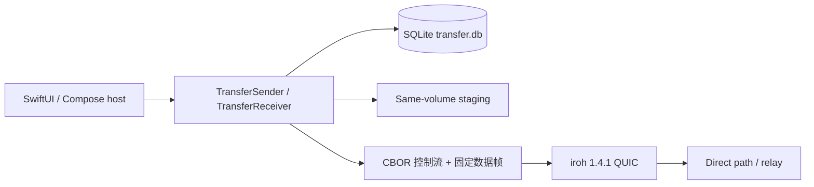
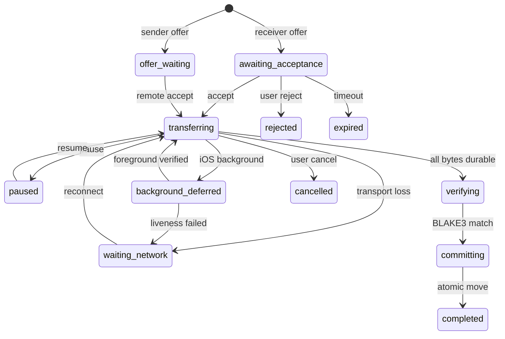

# Covio 单文件传输

- 状态：core implemented；平台 host 待接入
- 日期：2026-11-10
- Issue：#738
- 决策：[ADR-0035](../adr/adr-0035-cross-platform-product-scope.md)
- 研究：[Rust 文件传输](../research/rust-file-transfer/README.md)
- 依赖：[设备身份与二维码配对](device-pairing.md)

## 1. 结论

Rust core 已提供单文件发送、接收、SQLite 检查点和 iroh 传输适配。
接收文件先写目标卷内的 `.covio/staging`。
接收端完成 BLAKE3 校验后，用原子重命名提交最终文件。
iOS 后台策略由 core 状态机保存，平台 host 负责发送生命周期事件。



## 2. 协议合同

| 项目 | 合同 |
| --- | --- |
| 应用协议 | `covio-transfer/1` |
| ALPN | `covio/transfer/1` |
| 控制消息 | 长度前缀 CBOR |
| 数据流 | 每个文件一条单向流 |
| 数据帧 | 固定头 + BLAKE3 + payload |
| 分块 | `1 MiB` |
| 发送窗口 | `8 MiB` |
| 单文件上限 | `10 GiB` |
| 报价有效期 | `10 min` |

控制消息包含 offer、accept、reject、checkpoint、resume、cancel 和 complete。
控制序号在单个会话内严格递增。
会话使用随机 nonce。
数据流先发送文件头和最终 BLAKE3。
每个分块再包含偏移、长度和分块 BLAKE3。

## 3. 状态机



状态和检查点写入 SQLite。
当前实现每个 `1 MiB` 分块后写检查点，检查点间隔不超过研究合同的 `16 MiB`。
应用崩溃后，core 读取任务记录并恢复可验证的检查点。
身份、清单或暂存字节不一致时，core 不自动续传。

## 4. 接收落盘

暂存路径位于目标目录所在的文件系统。

```text
<destination>/
├── .covio/staging/<transfer-id>/<file-name>.part
└── <file-name>
```

接收端执行以下顺序。

1. 校验传输状态和下一分块偏移。
2. 校验分块 BLAKE3。
3. 追加到暂存文件。
4. 同步文件，并在 SQLite 事务中记录分块和偏移。
5. 全部字节到齐后计算文件 BLAKE3。
6. 校验通过后原子重命名到最终路径。
7. 将任务标记为 `completed`。

任一步失败时，最终路径不出现半成品。
取消和失败保留暂存文件，由保留策略清理。

## 5. 续传和移动端

发送端从接收方持久偏移继续读取。
发送端只读取 ACK 后 `8 MiB` 窗口内的数据。
接收端拒绝跳块、重复偏移冲突、损坏分块和越界检查点。
完全相同的重复分块按幂等 ACK 处理，不重复追加。

iOS 进入后台时，host 调用 `background`。
core 要求此调用发生在当前分块同步完成之后。
回到前台时，host 先重新验活连接。
host 再提交可信状态、设备标识、清单摘要和连接结果。
core 校验暂存文件和全部持久分块，然后返回恢复偏移。

## 6. iroh 边界

`IrohTransferEndpoint` 负责绑定端点、连接已配对设备并接受入站连接。
`IrohTransferChannel` 负责控制流、单向文件流和帧的读写。
`DeviceIdentityService::bind_transfer_endpoint` 复用配对 Ed25519 密钥。
发送连接用已配对设备公钥固定 iroh EndpointId。
入站连接可以读取已认证远端公钥，并对照可信设备记录。
业务状态不进入传输适配器。
传输断线映射为 `transport_offline`。
调用方根据持久检查点创建新会话。

iroh `1.4.1` 的 iOS 构建依赖 `netdev 0.46.3`。
`libc 0.2.190` 将 `in6_ifreq` 限制为 macOS。
因此工作区固定 `libc 0.2.189`。

## 7. 代码入口

| 模块 | 责任 |
| --- | --- |
| `file_transfer/mod.rs` | 协议、清单、帧、窗口和错误码 |
| `file_transfer/store.rs` | SQLite 任务、检查点和事件 |
| `file_transfer/sender.rs` | 发送任务、窗口和 ACK |
| `file_transfer/receiver.rs` | 暂存、恢复校验和原子提交 |
| `file_transfer/iroh_transport.rs` | iroh QUIC 控制流和数据流 |

## 8. 验证

单元测试覆盖以下场景。

- 完整单文件往返。
- 损坏分块。
- 重复分块。
- 取消。
- 报价过期。
- 后台重启和前台恢复。
- 文件最终校验失败。
- 8 MiB 发送窗口。
- 路径穿越。
- 发送端检查点重启恢复。
- 空文件。

`cargo test -p covio-core --test file_transfer` 通过。
`cargo clippy -p covio-core --all-targets -- -D warnings` 通过。
`cargo check -p covio-core --target aarch64-apple-ios` 通过。

## 9. 未决事项

- SwiftUI 和 Compose host 尚未接入文件选择、确认界面和生命周期事件。
- 目录和其他冲突策略由 #739 实现。
- 三平台真实传输由 #743 验收。
- 当前测试不覆盖公网 relay 断开和真实设备后台恢复。
