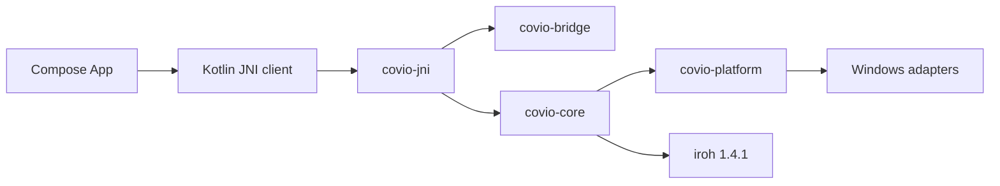

# Windows Compose host

- 状态：opt-in prototype validated on hosted Windows; physical acceptance pending
- 日期：2026-11-11
- 决策：[ADR-0035](../adr/adr-0035-cross-platform-product-scope.md)
- 依赖：[Compose 与 Rust bridge](../research/compose-rust-bridge/solution.md)

## 1. 结论

Windows 保留 egui 默认产物。
Compose host 作为独立 opt-in 路径构建和验收。
Compose 只负责 UI 和平台 adapter。Rust core 继续拥有配对、传输、能力、持久化和错误语义。



## 2. 组件

| 组件 | 路径 | 责任 |
| --- | --- | --- |
| Compose app | `composeApp/` | 页面、输入、主题、测试和平台请求 |
| JNI bridge | `rust/crates/covio-jni/` | session、JNI 入口、事件队列、panic containment |
| Capability model | `rust/crates/covio-platform/src/capabilities.rs` | 能力状态和 adapter 边界 |
| Windows package | `scripts/package-windows-compose.sh` | 从发布清单读取版本，并生成 `jlink` runtime 和 `jpackage` app image |

## 3. JNI 行为

1. `nativeOpenSession` 创建 generation 句柄。
2. `nativeConfigure` 配置 data root、系统信息和 host adapter 报告。
3. `nativeDispatch` 校验 request envelope，执行命令，返回 response envelope。
4. `nativeNextEvent` 从有界事件队列读取事件。
5. `nativeCancel` 设置请求取消标记并写入 cancel envelope。
6. `nativeShutdown` 拒绝新请求并停止 session。
7. 每个 JNI 入口捕获 Rust panic。
8. 文件内容不进入 JSON control channel。

## 4. Compose 页面

| 页面 | 用户结果 |
| --- | --- |
| Devices | 只读展示本机系统、版本、在线状态、可信设备能力 |
| Pair | 创建二维码、接受二维码报价、核对六位确认码 |
| Send | 选择可信设备、选择文件、启动发送 |
| Receive | 选择目标目录、等待接收、显示进度 |

## 5. 能力规则

Compose 不直接决定能力是否可用。
Compose 先调用 `capability.request`。Rust 检查 host adapter 报告并返回 request token。平台 adapter 完成 OS 操作后调用 `capability.complete`。文件选择结果以 lease 形式交回 Rust。

当前 host 报告以下 adapter：

- `file_picker`
- `notification`
- `background_task`
- `app_lifecycle`

`share_sheet` 和 `notification_activation` 在 Windows prototype 中保持不可用。UI 不显示未实现能力。

## 6. 验证命令

```sh
bash scripts/test-windows-compose.sh
bash scripts/package-windows-compose.sh
pwsh -NoProfile -File scripts/performance/windows_compose_baseline.ps1 \
  -AppDirectory build/windows-compose-package/app-image/Covio \
  -PackageDirectory build/windows-compose-package
```

## 7. 当前验证与未完成项

Windows Compose host 从 `release/release-manifest.json` 读取 `clientVersion`。
生成物为 `composeApp/src/main/kotlin/com/covio/release/GeneratedReleaseIdentity.kt`。
Windows 2025 x64 托管 runner 已验证以下结果。

- Compose、JNI、Kotlin round-trip 和无障碍合同通过。
- 亮色、深色和配对页面截图已生成。
- `jlink` runtime、`jpackage` app image、便携 ZIP 和 MSI 已生成。
- 包内 headless smoke 和五次性能基线运行通过。

仍未完成以下验收。

- 真实 Windows 11 设备之间的 iroh 传输需要网络、relay 和 discovery 证据。
- `share_sheet`、通知激活和完整 tray 行为尚未接入。
- 未通过功能和视觉评审前，默认 UI 继续为 egui。
